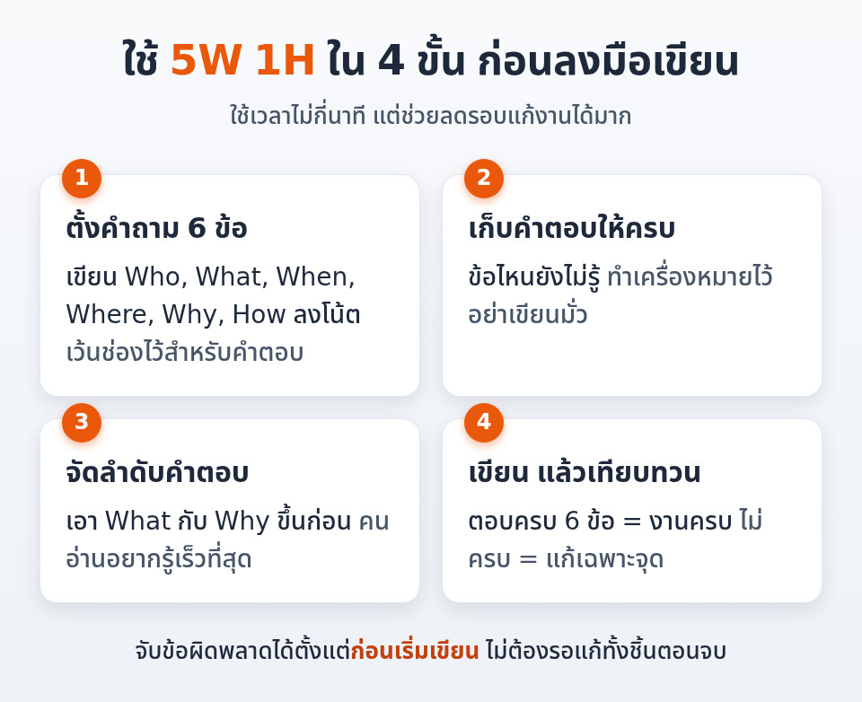
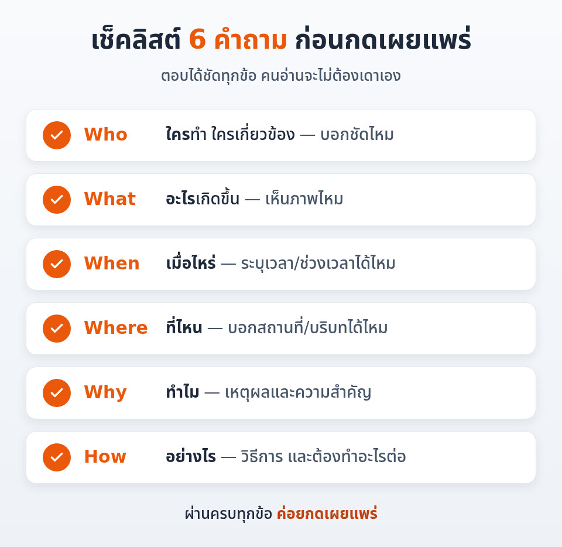

## ปัญหาของนักเขียนมือใหม่: เขียนแล้วคนอ่านไม่รู้เรื่อง

นักเขียนมือใหม่เจอบ่อย ๆ อย่างหนึ่งคือ เขียนเสร็จแล้วคนอ่านถามกลับมาว่า "แล้วมันเกิดขึ้นที่ไหน" "เมื่อไหร่" "ทำไมถึงเกิด" คำถามเหล่านี้ไม่ใช่เพราะคนอ่านอ่านไม่ออก แต่เพราะข้อความของเราขาดข้อมูลสำคัญไป

ลองนึกภาพตาม: เราเขียนว่า "เมื่อวานมีกิจกรรมทำความสะอาด ชาวบ้านมาร่วมกันเยอะมาก น่าสนใจดี" อ่านจบแล้วรู้สึกว่าเห็นภาพไหม ส่วนใหญ่ตอบว่าไม่ เพราะข้อความนี้บอกว่ามีอะไรเกิดขึ้น (What) กับบอกว่าเมื่อไหร่ (When) แบบคร่าว ๆ แต่ไม่บอกว่าเกิดที่ไหน (Where) ใครเป็นคนจัด (Who) จัดทำไม (Why) และจัดยังไง (How) แต่ละช่องว่างที่หายไป คือจุดที่คนอ่านต้องเดาเอง พอต้องเดาเยอะเข้า เขาก็เลิกอ่าน

ปัญหาแบบนี้ไม่ได้เกิดจากภาษาไม่ดีหรือเขียนน้อยเกินไป แต่เกิดจากการไม่มีระบบตรวจงานก่อนส่ง นักเขียนที่ยังใหม่มักเขียนจากความรู้สึก คิดได้อะไรก็ใส่ลงไป แล้วก็ลืมสิ่งที่ตัวเองรู้เพราะคนเขียนรู้เรื่องอยู่แล้วในหัว แต่คนอ่านไม่ได้นั่งอยู่ในหัวของเรา

เครื่องมือที่ช่วยได้และใช้กันมานานมากในวงการข่าวคือ 5W1H คำถามหกข้อที่ทำหน้าที่เหมือนตารางตรวจงาน ทำให้เห็นช่องว่างในข้อความก่อนที่จะถึงมือคนอ่าน

## 5W 1H คืออะไร และมาจากไหน

5W1H คือคำถามหกข้อพื้นฐานที่ใช้ตอบว่า เรื่องราวหนึ่ง "ครบ" หรือยัง ได้แก่ Who, What, When, Where, Why และ How คำว่า 5W1H เป็นการย่อจากภาษาอังกฤษ แต่หลักการนี้ใช้ข้ามภาษาได้เพราะเป็นแค่คำถามที่มนุษย์ทุกคนถามกันอยู่แล้ว

ต้นกำเนิดของมันอยู่ในงานข่าว นักข่าวรุ่นเก่าถูกสอนให้ตอบคำถามเหล่านี้ให้ได้ก่อนเขียนข่าว เพราะข่าวที่ดีต้องให้ผู้อ่านรู้เรื่องด้วยตัวเอง ไม่ต้องตีความเพิ่ม สำนักข่าวใหญ่ ๆ หลายแห่งยังใช้หลักนี้เป็นมาตรฐานตรวจต้นฉบับมาจนถึงทุกวันนี้ และเมื่อเวลาผ่านไป คนก็นำหลักเดียวกันไปใช้กับการเขียนทุกรูปแบบ ทั้งรายงาน ธุรกิจ บล็อก และโพสต์โซเชียล

ข้อดีของ 5W1H คือมันไม่ใช่สูตรลับอะไรเลย เป็นแค่คำถามหกข้อ แต่คุณค่าของมันอยู่ที่ "ความเป็นระเบียบ" มันบังคับให้เราช้าลงหนึ่งจังหวะก่อนเขียน แล้วถามตัวเองว่ารู้ครบหรือยัง คำถามหกข้อนี้จึงเหมาะที่สุดกับนักเขียนมือใหม่ เพราะใช้ได้ทันที ไม่ต้องเรียนรู้ทฤษฎีอะไรเพิ่ม

## ทีละตัว: Who, What, When, Where, Why, How

มาดูกันทีละข้อ แต่ละตัวมีคำถามนำของตัวเอง ลองใช้ถามงานของตัวเองตามได้เลย

**Who (ใคร)** – เกี่ยวข้องกับใครบ้าง ทั้งคนที่ลงมือทำ คนที่ได้รับผลกระทบ และคนที่ควรรู้เรื่องนี้ คำถามนำ: "ใครเป็นคนทำ ใครเกี่ยวข้อง ใครควรอ่านเรื่องนี้"

**What (อะไร)** – มีอะไรเกิดขึ้นกันแน่ อธิบายเหตุการณ์หรือเรื่องที่จะเล่าให้เป็นรูปเป็นร่าง ไม่ใช่คำกว้าง ๆ คำถามนำ: "เกิดอะไรขึ้น มีรายละเอียดอะไรบ้าง"

**When (เมื่อไหร่)** – ช่วงเวลาของเรื่อง ทั้งเวลาที่เกิดเหตุและระยะเวลาที่เกิด คำถามนำ: "เกิดขึ้นเมื่อไหร่ นานแค่ไหน ยังเกิดอยู่ไหม"

**Where (ที่ไหน)** – สถานที่หรือบริบทที่เรื่องนี้เกิดขึ้น คำถามนำ: "เกิดที่ไหน แพร่ไปถึงไหนแล้ว"

**Why (ทำไม)** – เหตุและผล ทำไมเรื่องนี้ถึงเกิดขึ้น ทำไมผู้อ่านควรสนใจ คำถามนำ: "ทำไมถึงเกิด ทำไมถึงสำคัญ"

**How (อย่างไร)** – กลไกและวิธีการ เรื่องนี้ดำเนินไปยังไง หรือผู้อ่านต้องทำอะไรต่อ คำถามนำ: "ทำยังไง เกิดขึ้นได้ยังไง ใช้ได้ยังไง"

สังเกตว่าสองตัวหลังอย่าง Why กับ How มักเป็นจุดที่นักเขียนมือใหม่ละไว้ เพราะทั้งคู่ต้องอธิบายเพิ่ม ไม่ใช่แค่บอกข้อเท็จจริงสั้น ๆ แต่สองข้อนี้เองที่ทำให้เรื่องของเรามีน้ำหนักและน่าเชื่อถือกว่าข้อความที่มีแค่ใคร อะไร เมื่อไหร่ ที่ไหน

## วิธีใช้ step-by-step ก่อนลงมือเขียน

นี่คือลำดับการทำงานที่แนะนำ ทำตามทีละขั้นได้เลย ใช้เวลาไม่กี่นาที

**ขั้นที่ 1: ตั้งคำถามทั้งหกข้อก่อนเขียน** ก่อนพิมพ์อะไรสักอย่าง ให้เขียนคำถาม Who, What, When, Where, Why, How ลงบนกระดาษหรือในไฟล์โน้ต เว้นช่องไว้สำหรับคำตอบ การเขียนคำถามก่อนทำให้สมองเปลี่ยนจาก "จะเล่าอะไรดี" เป็น "ต้องรู้อะไรบ้าง"

**ขั้นที่ 2: เก็บคำตอบให้ครบ** ตอบทุกข้อเท่าที่รู้ตอนนี้ ถ้าข้อไหนยังไม่รู้ ให้ทำเครื่องหมายไว้ชัด ๆ อย่าเขียนมั่ว ขั้นนี้คือหัวใจ เพราะช่องว่างที่เห็นตรงหน้าคือสิ่งที่ต้องไปหาข้อมูลเพิ่ม หรือถ้าหาไม่ได้จริง ๆ ก็จะได้รู้ว่าต้องบอกผู้อ่านอย่างตรงไปตรงมาว่าส่วนนี้ยังไม่ยืนยัน

**ขั้นที่ 3: จัดลำดับคำตอบ** ข้อมูลดิบทั้งหกช่องยังไม่ใช่โครงเรื่อง ให้จัดใหม่ตามความสำคัญ เคล็ดลับคือเอา What กับ Why ไว้ก่อน เพราะผู้อ่านอยากรู้เร็วที่สุดว่าเกิดอะไรขึ้นและสำคัญตรงไหน ส่วน When กับ Where ซึ่งเป็นรายละเอียดปลีกย่อยมักตามมาทีหลัง Who และ How ใช้เสริมให้เรื่องสมบูรณ์

**ขั้นที่ 4: เริ่มเขียนตามลำดับที่จัดไว้** เขียนย่อหน้าแรกโดยยึดข้อมูลจากขั้นที่ 3 แล้วไล่รายละเอียดลงไป เสร็จแล้วอ่านทวนอีกรอบโดยเทียบกับคำถามทั้งหกข้อตอนขั้นที่ 1 ถ้าตอบได้หมดแปลว่างานครบ ถ้าข้อไหนยังตอบไม่ได้ ให้กลับไปแก้เฉพาะจุดนั้น

ขั้นตอนทั้งสี่นี้ดูเหมือนเยอะ แต่พอทำซ้ำสองสามครั้งจะใช้เวลาแค่ไม่กี่นาที และช่วยลดรอบแก้งานได้มาก เพราะปัญหาส่วนใหญ่ถูกจับได้ตั้งแต่ก่อนเริ่มเขียนแล้ว

## ตัวอย่างที่ 1: การเขียนข่าวชุมชน

สมมติว่าเราเขียนข่าวให้เว็บไซต์ชุมชน เรื่องคือ ตลาดนัดชุมชนจัดกิจกรรมแจกถุงยังชีพให้ผู้สูงอายุ

**แบบไม่ใช้ 5W1H:**

> เมื่อเร็ว ๆ นี้ ที่ตลาดนัด มีการแจกของให้ผู้สูงอายุ ซึ่งเป็นกิจกรรมที่ดีมาก ชาวบ้านต่างพากันชมว่าควรจัดขึ้นอีก และหวังว่าจะมีกิจกรรมดี ๆ แบบนี้เรื่อย ๆ

อ่านจบแล้วรู้อะไรบ้าง รู้ว่ามีการแจกของและมีคนชม แต่ไม่รู้ว่าแจกอะไร แจกเมื่อไหร่ ที่ตลาดนัดไหน ใครเป็นคนจัด จัดเพราะอะไร และแจกยังไง ข้อความแบบนี้คนอ่านใช้ตัดสินใจไม่ได้เลยว่าจะไปร่วมครั้งหน้าได้ไหม

**แบบใช้ 5W1H (Who, What, When, Where, Why, How):**

> สมาคมแม่บ้านตลาดนัดคลองถม (Who) แจกถุงยังชีพ 200 ถุงให้ผู้สูงอายุในชุมชน (What) เมื่อวันเสาร์ที่ 15 พฤศจิกายน ที่ลานกิจกรรมหน้าตลาดนัดคลองถม (When, Where) เพื่อช่วยแบ่งเบาค่าใช้จ่ายครัวเรือนในช่วงปลายปี (Why) โดยผู้ที่สนใจแสดงบัตรประจำตัวประชาชนหน้างาน และรับได้คนละ 1 ถุง ตั้งแต่เวลา 09.00 น. เป็นต้นไป (How)

ลองเทียบทั้งสองแบบ ข้อความหลังยาวกว่าเล็กน้อย แต่ผู้อ่านได้ครบทุกอย่างที่ต้องใช้ตัดสินใจ และแต่ละส่วนโยงกับคำถามทั้งหกข้อโดยตรง สังเกตว่าเราไม่ได้ใส่คำวิเศษณ์สวย ๆ เพิ่มเลย แค่ใส่ข้อมูลให้ครบ ก็อ่านง่ายขึ้นเห็นได้ชัด

อีกจุดที่ควรสังเกตคือ ตัวเลขอย่าง "200 ถุง" "คนละ 1 ถุง" "09.00 น." คือสิ่งที่คนอ่านเอาไปใช้ได้จริง งานเขียนที่มี 5W1H มักมีรายละเอียดจับต้องได้แบบนี้ปนอยู่เสมอ เพราะคำถามอย่าง When และ How บังคับให้เราต้องตอบด้วยข้อมูลที่เฉพาะเจาะจง ไม่ใช่คำตอบกำกวม

## ตัวอย่างที่ 2: การสร้างคอนเทนต์/โพสต์โซเชียล

หลักเดียวกันใช้ได้กับโพสต์โซเชียล สมมติว่าเราเป็นเจ้าของคาเฟ่เล็ก ๆ แล้วจะประกาศงานอีเวนต์ชิมกาแฟ

**แบบไม่ใช้ 5W1H:**

> แวะมาร้านเรากันเยอะ ๆ นะ เรามีกิจกรรมดี ๆ มาให้ทุกคนได้สนุกกัน ห้ามพลาด!

โพสต์แบบนี้ดูมีพลัง แต่ไม่มีใครแชร์ต่อได้ เพราะไม่รู้ว่ากิจกรรมคืออะไร จัดเมื่อไหร่ ที่ไหน และทำไมต้องไป เจ้าของโพสต์รู้ทุกอย่างในหัว แต่คนที่เลื่อนฟีดผ่านไปมาใน 3 วินาทีแรกไม่รู้อะไรเลย

**แบบใช้ 5W1H:**

> ลองกาแฟไทยสายพันธุ์ดอยสูงฟรี 4 แบบ (What) ที่ร้านกาแฟบ้านพะยูง ซอยตลาดเก่า (Where) เสาร์นี้ 22 พฤศจิกายน 10.00-16.00 น. (When) เพราะเราอยากให้ทุกคนได้รู้จักกาแฟไทยที่ปลูกในบ้านเรา (Why) ชิมฟรี ไม่ต้องจอง มาก่อนได้ก่อน พร้อมส่วนลดเมล็ดกาแฟ 20% ตลอดวัน (How) เจ้าของร้านนั่งชงให้ทุกแก้วเอง (Who) ใครสายกาแฟไทยมาลองได้เลย

ลองอ่านสองแบบเทียบกัน แบบแรกสั้นกว่าแต่ไม่มีใครส่งต่อให้เพื่อนได้ ส่วนแบบที่สอง คนสามารถคัดลอกส่งให้เพื่อนพร้อมนัดพบกันทันที ความยาวเพิ่มขึ้นแค่ไม่กี่บรรทัด แต่คุณภาพการสื่อสารต่างกันมาก

เคล็ดลับสำหรับโซเชียลคือ ไม่จำเป็นต้องเรียงคำถามตามลำดับ Who ถึง How เสมอ สิ่งสำคัญคือทั้งหกข้อต้องอยู่ในโพสต์ครบ หลายโพสต์เลือกเอา What ขึ้นก่อนเพื่อดึงความสนใจ แล้วค่อยตามด้วย When กับ Where ซึ่งเป็นข้อมูลที่คนต้องการเร็วที่สุดสำหรับอีเวนต์ ที่เหลือค่อยแทรกในช่วงท้าย

## ข้อผิดพลาดที่พบบ่อย + เช็คลิสต์ท้ายบทความ

ข้อผิดพลาดที่พบบ่อยในการใช้ 5W1H มีไม่กี่อย่าง และป้องกันได้ทั้งหมด

- **ตอบคำถามได้แต่ยัดทุกอย่างไว้ย่อหน้าแรก** การมี 5W1H ครบไม่ได้แปลว่าต้องอัดทุกคำตอบในประโยคเดียว ถ้ายัดหมดจะอ่านไม่รู้เรื่องแย่กว่าเดิม ให้กระจายตามลำดับที่จัดไว้ในขั้นที่ 3 แทน
- **มีครบทุกข้อแต่คำตอบกว้างเกินไป** เช่น When ตอบว่า "เมื่อเร็ว ๆ นี้" หรือ Where ตอบว่า "ในชุมชน" คำตอบแบบนี้เท่ากับไม่ได้ตอบ ให้ระบุให้เจาะจงที่สุดเท่าที่มีข้อมูล
- **ละ Why กับ How เพราะขี้เกียจอธิบาย** สองข้อนี้คือส่วนที่ทำให้เรื่องน่าเชื่อถือ ถ้าไม่รู้จริง ๆ ให้บอกตรง ๆ ว่ายังไม่ทราบ อย่าเดา
- **ใช้ 5W1H แล้วลืมคนอ่าน** คำถามทั้งหกเป็นเครื่องมือตรวจงาน ไม่ใช่โครงที่ต้องเขียนทื่อ ๆ ตอบครบทุกข้อแล้ว ยังต้องตกแต่งภาษาให้อ่านลื่นในภายหลัง
- **เช็คเฉพาะตอนเขียนเสร็จ** ถ้ารอเช็คตอนจบ เราจะเสียเวลาแก้โครงเรื่องทั้งชิ้น ควรทำตั้งแต่ขั้นเตรียมตัวจะคุ้มกว่ามาก

**เช็คลิสต์ก่อนเผยแพร่** ผ่านครบทุกข้อค่อยกดเผยแพร่ได้เลย

1. Who – บอกชัดไหมว่าใครทำ และใครเกี่ยวข้อง
2. What – มีอะไรเกิดขึ้น รายละเอียดพอให้เห็นภาพไหม
3. When – ระบุเวลาหรือช่วงเวลาได้ไหม
4. Where – บอกที่หรือบริบทได้ไหม
5. Why – อธิบายเหตุผลหรือความสำคัญแล้วหรือยัง
6. How – บอกวิธีการหรือกลไกครบไหม ถ้าเป็นการเชิญชวน ผู้อ่านรู้ไหมว่าต้องทำอะไรต่อ

## ปิดท้าย: เริ่มลองใช้ 5W1H กับชิ้นงานถัดไป

5W1H ไม่ใช่ทฤษฎีใหม่ และไม่ใช่สูตรที่รับประกันว่าทุกชิ้นงานจะออกมาสมบูรณ์แบบ แต่มันคือกรอบตรวจงานง่าย ๆ ที่ตอบคำถามเดียวว่า "คนอ่านรู้ครบหรือยัง" และคำถามเดียวนี้ตอบโจทย์ปัญหาใหญ่ของนักเขียนมือใหม่เกือบทั้งหมด

วิธีเริ่มที่ง่ายที่สุดคือ เอาชิ้นงานที่เขียนเสร็จแล้วมาลองตรวจย้อนหลัง เขียนคำถามหกข้อไว้ข้าง ๆ แล้วดูว่าข้อความเดิมตอบได้ครบไหม ถ้าเจอช่องว่าง ก็เติมเฉพาะจุดนั้น ทำแบบนี้สองสามชิ้น รับรองว่าการตั้งคำถามก่อนเขียนจะกลายเป็นนิสัยไปเอง

ลองเลือกโพสต์หรือบทความถัดไปของคุณ แล้วใช้ Who, What, When, Where, Why, How เป็นด่านแรกก่อนลงมือเขียน แล้วดูว่าคนอ่านถามกลับมาน้อยลงไหม

## Sources

- [หลักการเขียนข่าว (สำนักส่งเสริมวิชาการ มหาวิทยาลัยราชภัฏนครราชสีมา)](https://apro.nrru.ac.th/apro/admin/pages/ckfinder/userfiles/files/%E0%B8%AB%E0%B8%A5%E0%B8%B1%E0%B8%81%E0%B8%81%E0%B8%B2%E0%B8%A3%E0%B9%80%E0%B8%82%E0%B8%B5%E0%B8%A2%E0%B8%99%E0%B8%82%E0%B9%88%E0%B8%B2%E0%B8%A7.pdf)
- [สร้างสรรค์คอนเทนต์ด้วย 5W1H Framework – Popticles](https://www.popticles.com/marketing/5w1h-framework-for-content-idea-generation)
- [กลยุทธ์ 5W1H กับการนำมาประยุกต์ใช้ทางการตลาด – JobsDB](https://th.jobsdb.com/th/career-advice/article/what-is-5w1h)
- [Story vs. Plot vs. Theme: Know Your 5Ws and H – Writers Helping Writers](https://writershelpingwriters.net/2023/06/story-vs-plot-vs-theme-know-your-5ws-and-h)
- [The 5W and 1H Framework in Academic Writing – UAF Center for Teaching and Learning](https://ctl.uaf.edu/2025/07/24/the-5w-and-1h-framework-in-academic-writing)
- [Journalists Use 5W1H for Engaging Content – Medium](https://medium.com/@erikvand/journalists-use-5w1h-for-engaging-content-it-s-simple-you-should-too-461edbbdf8d1)
