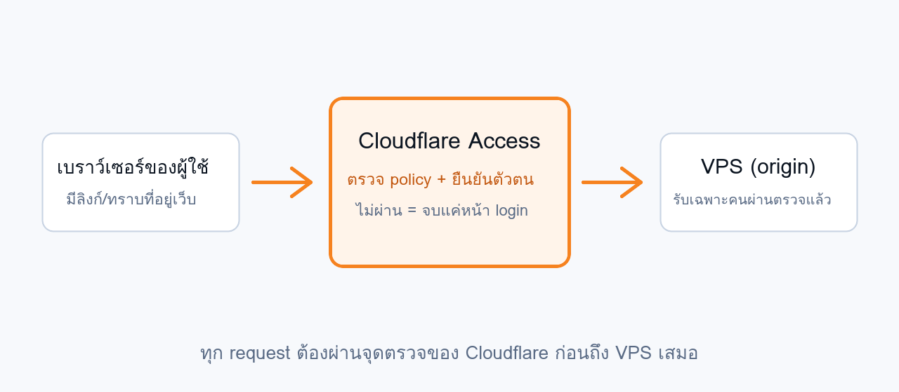

*Disclosure: บทความนี้เขียนจากประสบการณ์ใช้งานเอง ไม่มีสปอนเซอร์*

## Intro

เปิดเว็บบน VPS แล้วทิ้งพอร์ต 80/443 ไว้แบบ public ได้ไม่นาน ก็เริ่มมี bot วนมาเคาะทุก ๆ ไม่กี่นาที เปิด log ดูก็เห็น request จาก IP แปลก ๆ ทั้งวัน เว็บที่ยังไม่ทันประชาสัมพันธ์ก็โดนสแกนหาช่องโหว่จากเครื่องมืออัตโนมัติไปแล้ว

โจทย์ของเว็บส่วนตัวจึงเป็นการจำกัดคนเข้า ให้เฉพาะคนที่เราอนุญาต เพราะของที่อยู่ข้างในมีทั้งข้อมูลลับ ข้อมูลภายในองค์กร ไปจนถึงข้อมูลส่วนบุคคล และต้องป้องกันทั้งการเข้ามาอ่านกับการเข้ามาใช้งาน บริการ AI ที่ทุกคนมีลิงก์ก็เข้ามากดใช้ได้คือตัวอย่างชัด ๆ ถ้าไม่มีระบบยืนยันตัวตน คนไม่ประสงค์ดีจะเอาลิงก์นั้นไปสั่งงานจนทรัพยากร VPS หมด หรือใช้ AI เป็นเครื่องมือโจมตีระบบอื่น ส่วน firewall ที่ whitelist ตาม IP ใช้ยากเมื่อเราเปลี่ยน IP บ่อยตอนใช้เน็ตมือถือ และ VPN เต็มระบบก็ต้องลง client บนทุกเครื่องพร้อมดูแลเอง

Cloudflare Access ทำงานตามหลักนี้ ทุกครั้งที่มีคนเข้าเว็บ Cloudflare จะถามก่อนว่า "คุณคือใคร" ยืนยันตัวตนผ่าน Google, GitHub หรือ email จึงจะเห็นหน้าเว็บ คนที่ไม่ผ่านเห็นแค่หน้า login และไม่มีทางแตะเซิร์ฟเวอร์ของเรา ส่วน origin บน VPS ก็ไม่ต้องเปิดพอร์ตให้โลกภายนอกเห็น ผู้ใช้ไม่ต้องลงอะไรเพิ่ม

บทความนี้จะพาตั้งค่าตั้งแต่ต้นจนจบ เริ่มจากเตรียมโดเมนบน Cloudflare สร้าง Application เขียน policy ว่าให้ใครเข้าได้บ้าง ไปจนถึงทดสอบการใช้งานจริงและข้อควรระวังที่คนมักพลาด

## 1. ทำไมเว็บบน VPS ถึงโดนสแกนตลอดเวลา

เช่า VPS มาสักตัวแล้วเปิด web server ทิ้งไว้ ภายในไม่กี่ชั่วโมงก็เริ่มมี request แปลก ๆ เข้ามา bot เหล่านี้สแกนทุก IP บนอินเทอร์เน็ตอยู่แล้ว ไม่ต้องรอให้เว็บเราดัง เครื่องมืออย่าง Shodan หรือ Censys เก็บ database ของ port ที่เปิดอยู่ทั่วโลกไว้เรียบร้อย การเปิด 80/443 ทิ้งไว้จึงเท่ากับประกาศว่าที่นี่มีเซิร์ฟเวอร์

ปัญหาคือคนส่วนใหญ่แก้ผิดวิธี เช่น ย้าย port ไปที่ไม่คาดคิด หรือซ่อน URL ลับ ซึ่งแค่ชะลอไม่ได้ปิดกั้น

สิ่งที่ต้องทำคือจำกัดคนเข้า ไม่ใช่ซ่อนเว็บ ทุกคนที่เข้ามาต้องพิสูจน์ตัวตนก่อนจึงเห็นเนื้อหาจริง และใช้งานได้เฉพาะคนที่ได้รับอนุญาตเท่านั้น

## 2. Cloudflare Access คืออะไร

[Cloudflare Access](https://www.cloudflare.com/products/access) เป็นผลิตภัณฑ์กลุ่ม Zero Trust (หรือ ZTNA, Zero Trust Network Access) ทำงานแบบ identity-aware proxy คือนั่งอยู่หน้าเว็บเรา รับ request ทุกครั้งแล้วถามก่อนว่าผู้ส่งผ่าน policy หรือยัง ถ้าผ่านจึงส่งต่อไปที่ origin ถ้าไม่ผ่านก็เห็นแค่หน้า login ตามที่ [เอกสาร policies](https://developers.cloudflare.com/cloudflare-one/access-controls/policies) ระบุว่าแอปทุกตัวเป็น deny by default ต้องตรงเงื่อนไข policy สักข้อจึงจะเข้าได้

ต่างจาก firewall แบบเดิมที่รู้แค่ "มาจาก IP ไหน" ส่วน Access รู้ว่า "เป็นใคร" เช่น อีเมลไหน ล็อกอินผ่าน provider อะไร หรืออุปกรณ์ผ่านเกณฑ์หรือไม่ และต่างจาก VPN ตรงที่ผู้ใช้ไม่ต้องลง client ใด ๆ บนเครื่อง เปิดเบราว์เซอร์ไปที่ URL ก็เจอหน้า login ตามปกติ ใช้ได้ทั้ง desktop และมือถือ ไม่ต้องดูแล key หรือ config บนเครื่องใครเลย

## 3. เตรียมการณ์ก่อนเริ่ม

ก่อนลงมือเช็ค 3 อย่างนี้ให้พร้อม:

- **โดเมนอยู่บน Cloudflare แล้ว**: ต้องเป็น active zone ในบัญชี Cloudflare (full setup หรือ partial CNAME setup ก็ได้) เพราะเราจะเลือกโดเมนจาก dropdown ตอนสร้าง Application
- **บัญชี Cloudflare / Zero Trust**: สมัครฟรีและใช้ [แผนฟรีของ Cloudflare One](https://www.cloudflare.com/plans/zero-trust-services) ได้จริง (แผนฟรีรองรับผู้ใช้สูงสุด 50 คน พอสำหรับเว็บส่วนตัวและทีมเล็ก)
- **VPS ยังไม่ต้องเปิดพอร์ตให้โลกรู้จัก**: ถ้ายังไม่เคยเปิด public ก็อย่าเพิ่งเปิด ตั้ง Access ให้เสร็จก่อนค่อยเชื่อม เพราะเป้าหมายคือให้ traffic ผ่าน Cloudflare edge อย่างเดียว

เตรียมแค่นี้ก็เริ่มได้ ไม่ต้องติดตั้งอะไรบน VPS เพิ่ม

## 4. ตั้งค่า step-by-step

ขั้นตอนหลักตาม [เอกสาร self-hosted application](https://developers.cloudflare.com/cloudflare-one/access-controls/applications/http-apps/self-hosted-public-app):

1. เข้า Cloudflare dashboard → เมนู **Zero Trust** → **Access controls** → **Applications** → **Create new application**
2. เลือกประเภท **Self-hosted** แล้วกด **Add public hostname**
3. ในช่อง Domain เลือกโดเมนที่จะปกป้อง (จะใส่ path เฉพาะส่วน เช่น `example.com/admin` หรือใช้ wildcard เช่น `*.example.com` ก็ได้ แล้วแต่ว่าจะคุ้มครองส่วนไหน)
4. ส่วน **Access policies** คือส่วนที่กำหนดว่าใครเข้าได้บ้าง กดสร้าง policy ใหม่:
   - **Action**: เลือก `Allow`
   - **Include**: ใส่เงื่อนไขว่าให้ใครเข้าได้ เช่น `Emails` ระบุอีเมลของเราทีละคน, `Email domain` สำหรับทีม หรือ `Everyone` ซึ่งเอกสารเตือนชัดว่าเป็น misconfig ยอดนิยมที่ทำให้แอปเปิดหมด อย่าเผลอใช้กับเว็บที่ต้องการจำกัดจริง
5. เลือก **identity provider** สำหรับยืนยันตัวตน: Google, GitHub หรือจะใช้ **[one-time PIN](https://developers.cloudflare.com/cloudflare-one/integrations/identity-providers/one-time-pin/)** ที่ส่ง code ทาง email ก็ได้ ไม่ต้องตั้ง OAuth app อะไรเพิ่ม เหมาะกับการใช้ส่วนตัวมากที่สุด ส่วนคนที่อยากให้ทีมทั้งหมดเข้าได้โดยไม่ต้องไล่กรอกอีเมล ก็ใช้ selector อย่าง `Email domain` แทนได้ใน policy เดียว
6. กด Save เท่านี้ request ทุกครั้งที่เข้าโดเมนนี้จะถูก Access ดักไว้ก่อนถึง VPS

แนะนำให้เริ่มจาก allow เฉพาะอีเมลตัวเองก่อน ค่อยขยายทีหลัง

## 5. ทดสอบการใช้งานจริง

อย่าเพิ่งวางใจว่าตั้งเสร็จแล้วจบ ลองเอง 4 กรณี:

- **Desktop + incognito**: เปิด URL ควรเจอหน้า login เลือก Google/GitHub/one-time PIN ก่อน จึงเห็นหน้าเว็บจริง
- **มือถือ**: ลองจาก browser บนมือถือ (คนละเครื่องคนละ network ยิ่งดี) เพราะเป็นจุดที่มักลืมทดสอบ
- **หลุดได้ยังไง**: ถ้าเข้าหน้าเว็บได้โดยไม่ต้อง login ให้เช็ค 3 อย่าง: policy เลือกผิด (เช่น Include Everyone), โดเมน/path ที่กรอกใน Application ไม่ครอบคลุม URL ที่เราเปิด หรือ origin เปิดรับตรงจาก IP อยู่แล้ว
- **หน้า login ทำงานจริง**: ลองกรอก email ผิด แล้วดูว่าถูกบล็อกจริง ไม่ใช่ redirect ไปหน้าเว็บเฉย ๆ

อีกทางคือลอง `curl -I https://app.example.com` จากเครื่องอื่นดู ถ้าได้ response จากหน้า login หรือ 403 แปลว่า Access ดักไว้แล้ว แต่ถ้าได้เนื้อเว็บจริงแสดงว่ายังรั่ว

## 6. ข้อควรระวังและข้อจำกัด

- **Origin ต้องไม่เปิดตรงให้ IP ทั่วไป**: นี่คือจุดที่คนพลาดบ่อยที่สุด Cloudflare Access คุ้มครองเฉพาะ traffic ที่ผ่านโดเมน ถ้าใครรู้ IP แล้วเข้า `http://IP` โดยตรงก็ยังเข้าได้ วิธีแก้ตาม [เอกสาร protect your origin](https://developers.cloudflare.com/fundamentals/security/protect-your-origin-server) คือ firewall ให้อนุญาตเฉพาะ [Cloudflare IP ranges](https://developers.cloudflare.com/fundamentals/concepts/cloudflare-ip-addresses) หรือใช้ Authenticated Origin Pulls / Cloudflare Tunnel ให้ origin รับได้แค่จาก Cloudflare เท่านั้น
- **Session หมดอายุต้องยืนยันใหม่**: ตาม [เอกสาร session management](https://developers.cloudflare.com/cloudflare-one/access-controls/access-settings/session-management) session ตั้งได้ตั้งแต่ 15 นาทีถึง 1 เดือน (default 24 ชั่วโมง) ครบกำหนดก็ถามรหัสใหม่ ใครที่ตั้งสั้นมากจะโดนถามบ่อย ตั้งยาวมากก็เสี่ยงเครื่องถูกหยิบใช้ต่อ
- **webhook และ bot ต้องมีทางแยก**: ระบบอัตโนมัติไม่มีคนคลิกหน้า login ให้ใช้ [Service Tokens](https://developers.cloudflare.com/cloudflare-one/access-controls/service-credentials/service-tokens) (อายุ token ได้ยาวสุด 1 ปี) หรือสร้าง policy `Service Auth` เฉพาะ path ที่เครื่องภายนอกต้องเรียก และหลีกเลี่ยง Bypass กว้าง ๆ แบบ `/api/*` ที่จะเปิดทั้ง API ทิ้งไว้

## 7. ไปดีไหม

**ไปดี ถ้า:** เป็นเว็บส่วนตัว, แดชบอร์ด admin, Homelab, เว็บที่ยังไม่พร้อมเปิดสาธารณะ, เครื่องมือภายในทีม 2-50 คน, ระบบที่เก็บข้อมูลลับ/ข้อมูลภายในองค์กร/ข้อมูลส่วนบุคคล หรือบริการอย่าง AI ที่ไม่อยากให้ใครมีลิงก์ก็เข้ามาใช้งานได้ฟรี ๆ ตั้งง่าย ใช้ฟรี ไม่ต้องดูแล VPN server ไม่ต้องลง client บนเครื่องใคร และลด attack surface ได้จริงเพราะ origin ไม่ต้องเปิดให้โลก

**ควรไปทางอื่น ถ้า:** เป็นเว็บสาธารณะที่ต้องการให้คนทั่วไปเข้าและติด SEO (Access จะปิดไม่ให้ bot ทั่วไปอ่านได้), ต้องการควบคุม infra ระดับลึกเองทั้งหมด หรือมี traffic ขนาดใหญ่และ workflow ซับซ้อนหลายระบบ ซึ่งชุดเครื่องมืออย่าง VPN หรือโซลูชัน SASE เต็มรูปแบบจะเหมาะกว่า

## สรุป

Cloudflare Access ตั้งจุดยืนยันตัวตนไว้หน้า VPS ทุก request ต้องผ่าน policy ก่อน จึงจะเห็นเนื้อหา ขั้นตอนคือสมัครบัญชี ผูกโดเมน สร้าง Application เขียน policy ให้ชื่อตัวเอง แล้วทดสอบทั้งบน desktop และมือถือ จุดที่ห้ามลืมคือปิดการเข้า origin ตรง ๆ ด้วย firewall และจัด Service Token ให้ webhook ก่อนเริ่มใช้งานจริง ทั้งหมดนี้ใช้เวลาไม่ถึงครึ่งชั่วโมง

## Sources

- [Cloudflare Access product page](https://www.cloudflare.com/products/access)
- [Publish a self-hosted application · Cloudflare One docs](https://developers.cloudflare.com/cloudflare-one/access-controls/applications/http-apps/self-hosted-public-app)
- [Access policies · Cloudflare One docs](https://developers.cloudflare.com/cloudflare-one/access-controls/policies)
- [One-time PIN login · Cloudflare One docs](https://developers.cloudflare.com/cloudflare-one/integrations/identity-providers/one-time-pin/)
- [Session management · Cloudflare One docs](https://developers.cloudflare.com/cloudflare-one/access-controls/access-settings/session-management)
- [Service tokens · Cloudflare One docs](https://developers.cloudflare.com/cloudflare-one/access-controls/service-credentials/service-tokens)
- [Protect your origin server · Cloudflare Fundamentals](https://developers.cloudflare.com/fundamentals/security/protect-your-origin-server)
- [Zero Trust & SASE Plans & Pricing · Cloudflare](https://www.cloudflare.com/plans/zero-trust-services)
