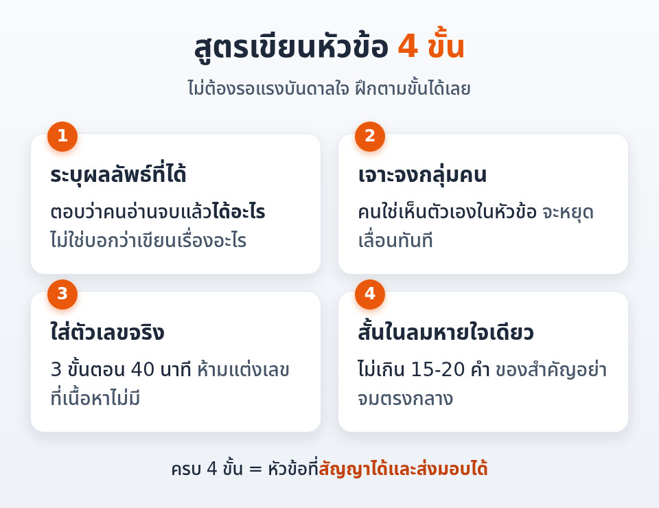
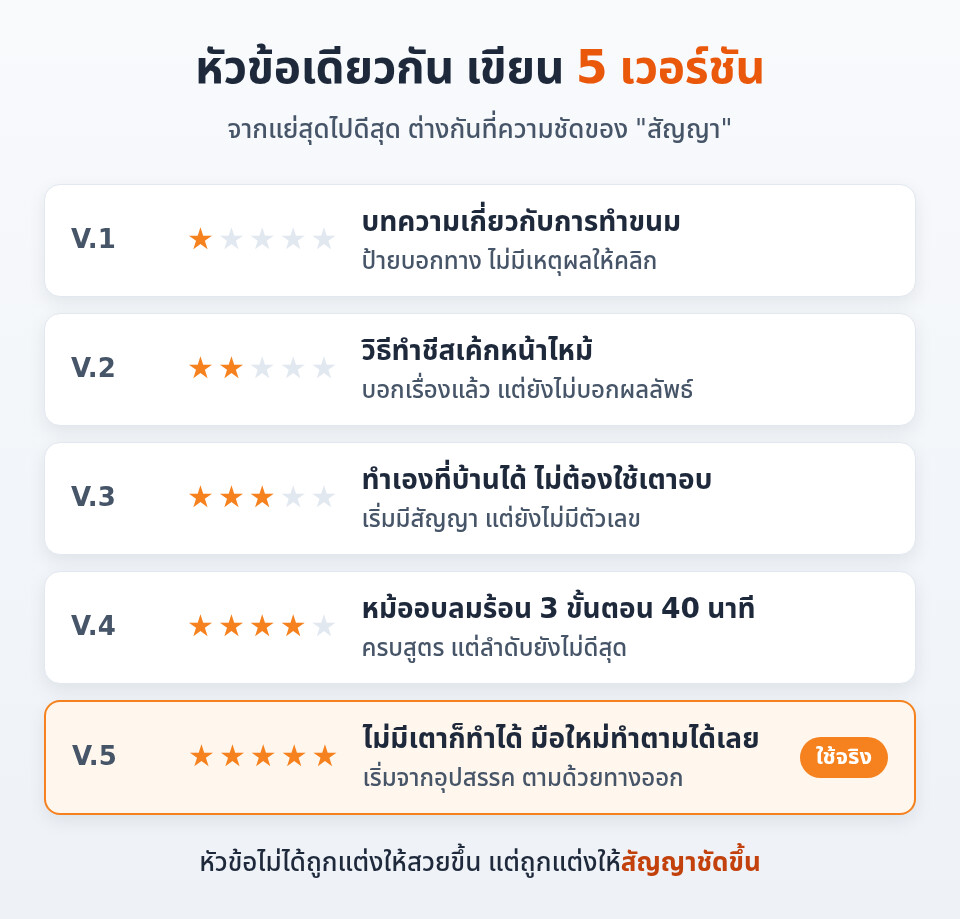

## คนอ่านหัวข้อแค่ไหนก่อนตัดสิน

ลองนึกถึงตัวเองตอนเลื่อนฟีดข่าวหรือหน้า Google ดู เวลาที่ใช้ต่อหนึ่งหัวข้อไม่ได้ยาวกว่าการกระพริบตาเสียอีก คำกล่าวคลาสสิกของ David Ogilvy นักโฆษณาชื่อดังบอกว่า มีคนอ่านหัวข้อมากกว่าอ่านเนื้อหาถึง 5 เท่า แปลว่าจากทุกคนที่ผ่านหัวข้อของคุณไป มีเพียงส่วนน้อยเท่านั้นที่จะกดเข้ามาอ่านต่อ

งานวิจัยยืนยันในทางเดียวกัน บทความจาก Nieman Journalism Lab ที่วิเคราะห์ผลการทดลอง A/B test หรือการทดสอบเปรียบเทียบหัวข้อสองแบบกับบทความเดียวกัน รวมกว่า 31,000 ครั้ง พบว่าหัวข้อที่ใช้คำง่าย สั้น และเล่าแบบเรื่องเล่า ได้คลิกมากกว่าหัวข้อที่ใช้คำยากหรือซับซ้อน ไม่ใช่หัวข้อที่ฉลาดที่สุดที่ชนะ แต่เป็นหัวข้อที่คนเข้าใจเร็วที่สุด

ซีรีส์เทคนิคการเขียนสำหรับมือใหม่ของเราเริ่มต้นที่ [5W 1H สำหรับนักเขียน](https://neng-lab.com/posts/5w1h-for-writers/) ตอนที่ 1 ซึ่งสอนการใช้คำถามหกข้อเรียงความคิดก่อนลงมือเขียน ตามด้วย [พีระมิดข่าว](https://neng-lab.com/posts/inverted-pyramid/) ตอนที่ 2 ที่สอนการวางข้อมูลสำคัญไว้บนสุดของย่อหน้าแรก และในตอนที่ 3 นี้ เราจะขยับขึ้นไปอีกขั้น ด้วยการเขียนสิ่งที่คนเห็นเป็นอันดับแรกและตัดสินใจเร็วที่สุด นั่นคือหัวข้อบทความ

## หัวข้อที่ดีคือสัญญา ไม่ใช่ป้ายบอกทาง

หัวข้อที่เขียนแบบขอไปทีมักทำหน้าที่เหมือนป้ายบอกทาง มันบอกว่าบทความนี้เขียนเรื่องอะไร เช่น บทความเกี่ยวกับการทำขนม หรือ ข่าวงานชุมชน ป้ายแบบนี้บอกสถานที่ แต่ไม่บอกเหตุผลที่ควรเดินเข้าไป

หัวข้อที่ดีทำหน้าที่ต่างออกไป มันคือสัญญาสั้น ๆ กับผู้อ่าน สัญญาที่บอกว่า ถ้าคุณกดเข้ามา คุณจะได้อะไรกลับไป เช่น ได้สูตรที่ทำตามได้ในวันนี้ รู้ว่าสะพานปิดวันไหนเพื่อวางแผนเดินทาง หรือรู้ว่าสินค้าชิ้นนี้คุ้มไหมก่อนเสียเงิน ความต่างอยู่ที่ประโยคแรกบอกเรื่อง ส่วนประโยคที่สองบอกผลลัพธ์ที่ผู้อ่านจะได้รับ

สัญญานี้โยงกับอีกสองตอนที่ผ่านมาโดยตรง เมื่อหัวข้อสัญญาว่าผู้อ่านจะได้อะไร คุณก็ต้องใช้ 5W 1H จากตอนที่ 1 ปลดล็อกสัญญานั้นออกเป็นองค์ประกอบครบถ้วน ว่าใครทำอะไร ที่ไหน เมื่อไหร่ ทำไม และอย่างไร จากนั้นย่อหน้าแรกตามโครงพีระมิดข่าวจากตอนที่ 2 ต้องรับสัญญาทันที โดยบอกผลลัพธ์สำคัญตั้งแต่สามวินาทีแรก ถ้าหัวข้อสัญญาไว้แล้วย่อหน้าแรกไม่รับ คนก็จะกดออก และจำได้ว่าเพจของคุณชอบสัญญาอะไรที่ไม่มีวันได้

## สูตรเขียนหัวข้อ 4 ขั้น

การเขียนหัวข้อที่ดีไม่ใช่พรสวรรค์ที่ต้องรอให้แรงบันดาลใจมาตก แต่เป็นขั้นตอนที่ฝึกตามได้ เรียงจากขั้นแรกถึงขั้นสุดท้ายดังนี้

**ขั้นที่ 1: ระบุประโยชน์หรือผลลัพธ์ที่ผู้อ่านจะได้**

ถามตัวเองก่อนว่า คนที่อ่านจบแล้วจะได้อะไรกลับไป จงตอบเป็นผลลัพธ์ ไม่ใช่หัวเรื่อง ถ้าคำตอบคือ ได้รู้วิธีทำชีสเค้ก ให้ขยับไปอีกขั้นเป็น ทำชีสเค้กเองได้ที่บ้านโดยไม่ต้องซื้อ ประโยคแรกบอกสิ่งที่คุณเขียน ประโยคที่สองบอกสิ่งที่เขาจะได้ และหัวข้อต้องใช้ประโยคที่สอง

**ขั้นที่ 2: เจาะจงกลุ่มคนหรือสถานการณ์**

ผลลัพธ์กว้าง ๆ ไม่ค่อยโดนใจใครเป็นพิเศษ การเจาะจงกลุ่มจะทำให้คนที่ใช่หยุดเลื่อนทันที เช่น เปลี่ยนจาก ทำขนมง่าย ๆ เป็น มือใหม่ที่ไม่เคยทำขนมมาก่อน ก็ทำได้ เมื่อคนอ่านเห็นตัวเองในหัวข้อ เขารู้สึกว่าบทความนี้เขียนให้เขา ไม่ได้เขียนให้คนทั่วไป

**ขั้นที่ 3: ใส่ตัวเลขหรือข้อเท็จจริงที่จับต้องได้**

ตัวเลขคือหลักฐานที่มองเห็นได้ในหนึ่งลมหายใจ เช่น 3 ขั้นตอน 40 นาที 5 สูตร หรือ 15 วัน ตัวเลขบอกทั้งปริมาณและความคุ้มค่าของเวลาที่ผู้อ่านกำลังจะเสีย หลักการง่าย ๆ คือถ้าข้อเท็จจริงในบทความมีตัวเลขจริง ให้ดึงออกมาใช้ในหัวข้อ และห้ามแต่งตัวเลขที่เนื้อหาไม่มี

**ขั้นที่ 4: ย่อให้อ่านจบในหนึ่งลมหายใจ**

หัวข้อที่ดีควรสั้นประมาณไม่เกิน 15 ถึง 20 คำ เพราะหัวข้อจะถูกตัดท้ายเมื่อแสดงบนหน้าค้นหาหรือหน้าฟีด จุดสำคัญที่สุดต้องอยู่ในช่วงต้นหรือท้ายประโยค ไม่ใช่จมหายไปตรงกลาง หลังเขียนเสร็จ ลองอ่านออกเสียงหนึ่งครั้ง ถ้าลมหายใจเดียวจบ ถือว่าผ่าน

## ชุดตัวอย่าง: หัวข้อเดียวกัน เขียน 5 เวอร์ชัน

เพื่อให้เห็นการทำงานของสูตรทั้ง 4 ขั้นแบบครบ เราจะใช้บทความเดียวกันเขียนหัวข้อ 5 เวอร์ชัน เรียงจากแย่สุดไปดีสุด เนื้อหาจริงของบทความคือ สอนทำชีสเค้กหน้าไหม้ด้วยหม้ออบลมร้อน ใช้วัตถุดิบหาซื้อง่าย ทำเสร็จใน 40 นาที แบ่งเป็น 3 ขั้นตอน ไม่ต้องใช้เตาอบ เหมาะกับคนที่ไม่เคยทำขนมมาก่อน

**เวอร์ชันที่ 1: บทความเกี่ยวกับการทำขนม**

วิเคราะห์: เวอร์ชันนี้แย่สุดเพราะแทบไม่ได้บอกอะไรเลย มันเป็นป้ายบอกทางที่บอกแค่เรื่องที่เขียน ไม่มีประโยชน์ ไม่มีกลุ่มคน ไม่มีตัวเลข และไม่มีเหตุผลที่ต้องกด คนที่เห็นหัวข้อนี้ในฟีดจะเลื่อนผ่านไปโดยไม่รู้สึกว่าเสียอะไรไป

**เวอร์ชันที่ 2: วิธีทำชีสเค้กหน้าไหม้**

วิเคราะห์: ดีขึ้นหนึ่งขั้นเพราะบอกหัวข้อเฉพาะเจาะจงแล้ว ผู้อ่านรู้ว่าบทความนี้สอนทำขนมชนิดไหน แต่ยังเป็นแค่การบอกเรื่อง ไม่ได้บอกผลลัพธ์ ไม่มีอะไรบอกว่าทำไมควรเป็นสูตรนี้ ไม่ใช่สูตรอื่น ที่สำคัญคือคำว่า วิธีทำ ใคร ๆ ก็เขียนได้ จึงไม่มีอะไรให้จำ

**เวอร์ชันที่ 3: ชีสเค้กหน้าไหม้ทำเองที่บ้านได้ ไม่ต้องใช้เตาอบ**

วิเคราะห์: เริ่มเห็นสัญญาชัดขึ้น เวอร์ชันนี้เพิ่มผลลัพธ์สองอย่าง คือทำเองที่บ้านได้ และไม่ต้องใช้เตาอบ ซึ่งตอบข้อสงสัยแรกของคนจำนวนมากที่อยากทำขนมแต่ไม่มีอุปกรณ์ ตอนนี้ผู้อ่านเริ่มรู้ว่าจะได้อะไร แต่ยังไม่มีตัวเลขและยังไม่เจาะจงว่าเป็นมือใหม่หรือคนที่ทำขนมเป็นอยู่แล้ว

**เวอร์ชันที่ 4: ชีสเค้กหน้าไหม้ในหม้ออบลมร้อน 3 ขั้นตอน 40 นาที มือใหม่ก็ทำได้**

วิเคราะห์: ใช้สูตรครบทุกขั้นแล้ว บอกอุปกรณ์ชัดว่าใช้หม้ออบลมร้อน มีตัวเลขจับต้องได้คือ 3 ขั้นตอนกับ 40 นาที และเจาะจงกลุ่มว่ามือใหม่ก็ทำได้ ผู้อ่านสามารถตัดสินใจได้ภายในหนึ่งลมหายใจว่าบทความนี้เหมาะกับตัวเองหรือไม่ จุดเล็กที่ยังปรับได้คือลำดับประโยคยังเริ่มจากของ ไม่ได้เริ่มจากประโยชน์

**เวอร์ชันที่ 5: ไม่มีเตาก็ทำชีสเค้กหน้าไหม้ได้ ด้วยหม้ออบลมร้อน 3 ขั้นตอน 40 นาที ที่มือใหม่ทำตามได้เลย**

วิเคราะห์: เวอร์ชันดีสุดเริ่มต้นด้วยอุปสรรคที่ผู้อ่านกังวลมากที่สุด คือไม่มีเตา แล้วจึงเสนอทางออกทันที ตามด้วยหลักฐานเป็นตัวเลขว่าทำได้ใน 3 ขั้นตอน 40 นาที และปิดท้ายด้วยการยืนยันกลุ่มคนว่ามือใหม่ทำตามได้เลย ทุกส่วนตอบสูตรครบทุกขั้น และทุกส่วนยังเป็นเรื่องจริงที่เนื้อหาส่งมอบได้ เมื่อเทียบทั้งห้าเวอร์ชัน จะเห็นว่าหัวข้อไม่ได้ถูกแต่งให้สวยขึ้นเรื่อย ๆ แต่ถูกแต่งให้สัญญาชัดขึ้นเรื่อย ๆ

## แล้ว clickbait ต่างจากหัวข้อดียังไง

ก่อนอื่นขออธิบายคำว่า clickbait เสียก่อน clickbait หรือที่แปลตรงตัวว่าเหยื่อคลิก หมายถึงหัวข้อที่เขียนขึ้นมาเพื่อล่อให้คนกดเข้ามาให้ได้ มากกว่าจะบอกความจริงว่าเนื้อหาข้างในมีอะไร ตัวอย่างเช่น สิ่งที่หมอฟันไม่เคยบอกคุณ หรือ วิธีรวยใน 7 วัน ที่พอเปิดอ่านกลับไม่พบคำตอบตามที่หัวข้อบอกไว้ หรือเนื้อหาไม่ได้หนักแน่นพอ

ความต่างระหว่างหัวข้อดีกับ clickbait จึงอยู่ที่เรื่องสัญญา หัวข้อดีสัญญาเท่าที่เนื้อหาส่งมอบได้ ส่วน clickbait สัญญาเกินจริง คนกดเข้ามาเพราะถูกสัญญา แล้วพบว่าของที่ได้ไม่ตรงตามนั้น บางคนอาจอ่านจบด้วยความรู้สึกว่าเสียเวลา หลายคนกดออกภายในไม่กี่วินาที

ผลเสียไม่ได้จบแค่คลิกเดียวที่เสียไป งานวิจัยเกี่ยวกับ clickbait รวมถึงรายงานจาก Center for Media Engagement ชี้ว่าเนื้อหาแบบ clickbait อาจไม่คุ้มกับคลิกที่ได้มา เพราะผู้อ่านที่ผิดหวังหนึ่งครั้งจะจำได้ว่าเพจของคุณชอบสัญญาอะไรที่ไม่จริง ครั้งต่อไปที่คุณเขียนหัวข้อดี ๆ จริง ๆ เขาก็จะเลื่อนผ่านก่อน ระยะยาวสิ่งที่เสียไปไม่ใช่แค่จำนวนคลิก แต่คือความไว้ใจที่สร้างใหม่ได้ยากกว่าเดิมมาก

## ข้อผิดพลาดที่พบบ่อย

1. **หัวข้อกว้างเกินไปจนไม่มีอะไรจับต้อง** เช่น บทความเกี่ยวกับการดูแลสุขภาพ หรือ เรื่องดี ๆ ที่ควรรู้ หัวข้อแบบนี้ใช้ได้กับทุกเรื่อง จึงไม่ได้บอกอะไรกับใครเลย
2. **ใส่คำว่า ทึ่ง หรือ พลาดไม่ได้ โดยเนื้อหาไม่มีอะไรพิเศษ** คำพวกนี้เป็นเครื่องมือของ clickbait เมื่อผู้อ่านเข้ามาแล้วพบว่าเนื้อหาธรรมดา ก็จะหมดความไว้ใจในครั้งต่อ ๆ ไป
3. **หัวข้อยาวเกินไป** หัวข้อที่ยาวเกิน 20 คำมักถูกตัดท้ายบนหน้าค้นหาหรือฟีด จนข้อความสำคัญที่คุณอุตส่าห์วางไว้ตรงกลางจมหายไปทั้งที่เขียนดีแล้ว
4. **หลอกให้คลิกด้วยคำถามที่หัวข้อตัวเองตอบอยู่แล้ว** เช่น คุณรู้หรือไม่ว่าการนอนดึกไม่ดีต่อสุขภาพหรือไม่ ผู้อ่านเห็นคำตอบในหัวข้อทันที ความอยากรู้หายไป เหลือเพียงความรำคาญ
5. **สัญญาในหัวข้อแล้วย่อหน้าแรกไม่รับ** เป็นข้อผิดพลาดที่เชื่อมกลับไปตอนที่ 2 โดยตรง หัวข้อสัญญาว่าจะบอกวิธีใน 3 ขั้นตอน แต่ย่อหน้าแรกกลับเล่าที่มาก่อนสามย่อหน้า คนจึงกดออกเพราะคิดว่าเข้ามาผิดที่

## เช็คลิสต์ก่อนกดเผยแพร่

ใช้รายการนี้ตรวจหัวข้อทุกครั้งก่อนกดเผยแพร่ ผ่านครบถือว่าพร้อม

- บอกประโยชน์หรือผลลัพธ์ที่ผู้อ่านจะได้ ไม่ได้บอกแค่ว่าเขียนเรื่องอะไร
- เจาะจงกลุ่มคนหรือสถานการณ์ชัดพอที่คนใช่จะหยุดเลื่อน
- มีตัวเลขหรือข้อเท็จจริงจับต้องได้ และเป็นเรื่องจริงที่เนื้อหาส่งมอบได้
- ยาวไม่เกิน 15 ถึง 20 คำ และอ่านจบในหนึ่งลมหายใจ
- จุดสำคัญไม่ถูกตัดหายเมื่อแสดงผลแบบสั้นบนฟีดหรือหน้าค้นหา
- ไม่ใช้คำล่อคลิกอย่าง ทึ่ง หรือ พลาดไม่ได้ โดยไม่มีเนื้อหาสนับสนุน
- ย่อหน้าแรกตอบรับสัญญาจากหัวข้อได้ทันทีภายในไม่กี่วินาที
- ลองนึกภาพคนที่อ่านจบแล้วรู้สึกว่าได้ของตามสัญญา ไม่รู้สึกว่าถูกหลอก

หัวข้อที่ดีไม่ได้มาจากการเดา แต่มาจากการฝึกเขียนหลาย ๆ เวอร์ชันแล้วเลือก บทส่งท้ายของบทความนี้จึงเป็นการบ้านสั้น ๆ หยิบบทความที่คุณกำลังจะเผยแพร่ แล้วเขียนหัวข้อให้ได้ 3 เวอร์ชัน เริ่มจากเวอร์ชันที่ปลอดภัยที่สุด เวอร์ชันที่เจาะจงที่สุด และเวอร์ชันที่สัญญาชัดที่สุด จากนั้นเทียบกับสูตร 4 ขั้นและเช็คลิสต์ด้านบน แล้วเลือกตัวดีสุดใช้จริง เมื่อทำซ้ำสองสามบทความ คุณจะเริ่มเห็นเองว่าหัวข้อแบบไหนที่คนของคุณหยุดเลื่อน

## Sources

- https://www.niemanlab.org/2024/08/readers-prefer-to-click-on-a-clear-simple-headline-like-this-one
- https://www.adobe.com/express/learn/blog/9-tips-for-writing-better-headlines
- https://pmc.ncbi.nlm.nih.gov/articles/PMC11152133
- https://mediaengagement.org/wp-content/uploads/2019/05/CME-Report-Clickbait-Content-May-Not-Be-Click-Worthy.pdf
- https://csmapnyu.org/research/academic-research/the-null-effects-of-clickbait-headlines-on-polarization-trust-and-learning
- https://spcollege.libguides.com/news/headlines
