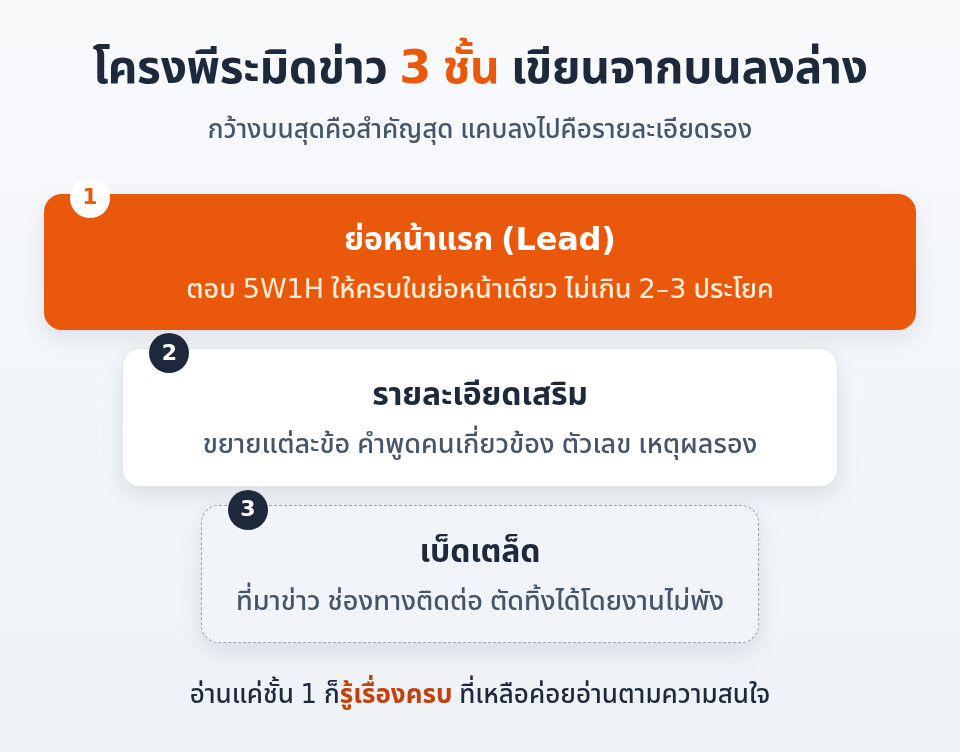
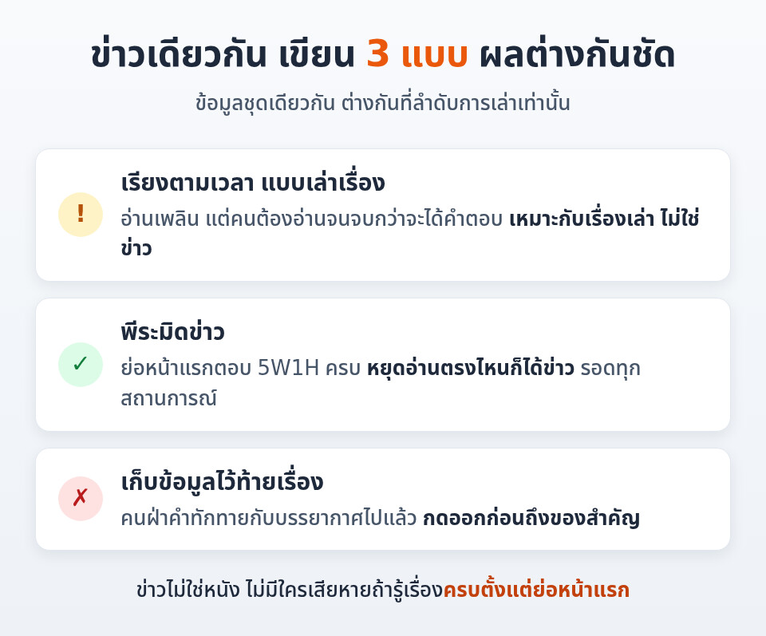

## ย่อหน้าแรก 3 วินาที ที่ตัดสินว่าคนจะอ่านต่อหรือไม่

คนที่คลิกเข้ามาอ่านข่าวหรือบทความของคุณ ส่วนใหญ่ใช้เวลาไม่เกิน 3 ถึง 5 วินาที ตัดสินใจว่าจะอ่านต่อหรือกดออกทันที ตัวตัดสินไม่ใช่พาดหัวอย่างเดียว แต่คือย่อหน้าแรก ถ้าย่อหน้าแรกไม่บอกอะไรเลยว่าเรื่องนี้เกี่ยวข้องกับอะไร คนก็ปิดหน้าทิ้งโดยไม่เสียดายแม้แต่น้อย

ตอนแรกของซีรีส์นี้เราพูดถึง [5W 1H สำหรับนักเขียน](https://neng-lab.com/posts/5w1h-for-writers/) ไปแล้วว่าเป็นคำถามหกข้อ (ใคร ทำอะไร ที่ไหน เมื่อไหร่ ทำไม อย่างไร) ที่ช่วยเรียงความคิดก่อนลงมือเขียน ตอนที่ 2 นี้จะต่อจากตรงนั้น ด้วยเทคนิคการเขียนชื่อว่าพีระมิดข่าว หรือ inverted pyramid ซึ่งจะบอกวิธีนำ 5W1H ทั้งหกข้อมารวมไว้ในย่อหน้าแรกให้ครบในย่อหน้าเดียว เพื่อให้คนหยุดอ่านและอ่านต่อ

## พีระมิดข่าวคืออะไร

ให้ลองนึกภาพพีระมิดตั้งตรง ฐานกว้างอยู่ล่างสุด ปลายแหลมอยู่บนสุด การเล่าเรื่องแบบทั่วไปมักเป็นแบบนั้น ค่อย ๆ เริ่มจากเรื่องรอบข้าง ไต่ไปจนถึงจุดสำคัญที่สุดตอนท้าย

พีระมิดข่าว (inverted pyramid) คือการกลับภาพนั้นเอาไว้ ฐานกว้างซึ่งหมายถึงข้อมูลที่สำคัญที่สุด ถูกยกขึ้นไปไว้บนสุดของเรื่อง ส่วนปลายแหลมที่เป็นรายละเอียดไม่สำคัญ ถูกวางไว้ล่างสุด ลำดับเนื้อหาจึงเรียงจากมากไปหาน้อย ตามความสำคัญต่อผู้อ่าน ไม่ใช่ตามลำดับเวลาที่เพิ่งนึกออก

ที่มาของโครงนี้มาจากเทคโนโลยีเก่าอย่าง telegraph หรือโทรเลข สมัยที่ส่งข่าวกันเป็นสาย ถ้าสายขาดระหว่างทาง สิ่งที่ส่งไปก่อนต้องพอตีพิมพ์ได้ทันที นักข่าวจึงเรียนรู้ที่จะส่งใจความสำคัญของข่าวไปก่อนเสมอ เมื่อมาถึงยุคหนังสือพิมพ์ หลักเดียวกันทำให้บรรณาธิการตัดข่าวจากล่างขึ้นบนได้ เรียกว่า cutting from the bottom คือตัดท้ายเรื่องออกเท่าไหร่ก็ได้ เรื่องก็ยังสมบูรณ์

## ทำไมยุคออนไลน์และมือถือยังต้องใช้พีระมิดข่าว

หลายคนคิดว่าพีระมิดข่าวเป็นของเก่า เหมาะกับหนังสือพิมพ์กระดาษเท่านั้น แต่จริง ๆ แล้วตรงกันข้าม คนอ่านบนมือถือส่วนใหญ่ไม่ได้อ่านทีละบรรทัด แต่สแกนหัวข้อ ย่อหน้าแรก และประโยคแรกของแต่ละย่อหน้า เมื่อเห็นว่าเรื่องนี้เกี่ยวข้องกับตัวเอง จึงค่อยอ่านต่อ ถ้าสแกนแล้วไม่เห็นว่าเกิดอะไรขึ้น ก็เลื่อนหน้าออกภายในไม่กี่วินาที

นอกจากนั้นงานออนไลน์ยังต้องย่อความบ่อย เช่น ตัดให้พอดีพื้นที่หน้าเว็บ ตัดให้เหลือคำโปรยสั้น หรือดึงไปทำเป็นคำบรรยายภาพ ข่าวที่วางลำดับตามพีระมิดอยู่แล้ว จะถูกตัดจากท้ายเรื่องได้ทันทีโดยไม่ทำให้ใจความหายไป

สรุปสั้น ๆ ว่าพีระมิดข่าวไม่ได้ช่วยแค่คนเขียน แต่ช่วยทั้งคนอ่านที่มีเวลาไม่กี่วินาที และคนที่ต้องนำข่าวไปใช้ต่อ เช่น บรรณาธิการหรือคนทำเพจ

## โครง 3 ชั้น เขียนทีละขั้น

โครงพีระมิดข่าวแบ่งออกเป็น 3 ชั้น เขียนจากบนลงล่างได้ดังนี้

**ชั้นบนสุด: ย่อหน้าแรก (lead) ตอบ 5W1H ให้ครบในย่อหน้าเดียว**

นี่คือส่วนที่สำคัญที่สุดของทั้งเรื่อง เขียนให้สั้น ไม่เกิน 2 ถึง 3 ประโยค ภายในย่อหน้าเดียวต้องบอกให้ได้ว่า เกิดอะไรขึ้น (what) ที่ไหน (where) เมื่อไหร่ (when) ใครเกี่ยวข้อง (who) ทำไมเกิดขึ้น (why) และทำได้อย่างไรหรือต้องทำอย่างไร (how) ถ้าขาดข้อไหนไป ผู้อ่านจะต้องย้อนขึ้นไปหาเอง ซึ่งคนส่วนใหญ่ไม่ทำ

**ชั้นกลาง: รายละเอียดเสริม**

ชั้นนี้คือเนื้อข่าวส่วนที่เหลือ ขยายความว่าแต่ละ W เกิดขึ้นได้อย่างไร มีคำพูดของคนที่เกี่ยวข้อง มีข้อมูลประกอบ ตัวเลข หรือเหตุผลรองลงมา เรียงตามความสำคัญจากมากไปน้อยเช่นกัน

**ชั้นล่าง: เบ็ดเตล็ดที่ตัดได้**

ส่วนท้ายสุดเก็บรายละเอียดที่จำเป็นแต่ไม่เร่งด่วน เช่น ที่มาของข่าว วิธีติดต่อสอบถาม เวลาทำการที่เกี่ยวข้อง หรือคำอ้างอิง ชั้นนี้ออกแบบมาให้ตัดทิ้งได้โดยงานไม่พัง นั่นคือหัวใจของพีระมิด

## ตัวอย่างใหญ่: ข่าวเดียวกัน เขียน 3 แบบ

เพื่อให้เห็นความต่างชัดเจน เราจะใช้ข่าวในชุมชนเดียวกัน เขียน 3 แบบ เรื่องสมมติคือ

> เทศบาลตำบลหนองยางประกาศปิดสะพานข้ามคลองหน้าโรงเรียนบ้านหนองยาง เพื่อซ่อมแซมโครงสร้าง 15 วัน ตั้งแต่วันที่ 1 ถึง 15 ธันวาคมนี้ ระหว่างปิดซ่อม เทศบาลจัดรถรับส่งนักเรียนฟรีช่วงเช้าและเย็น และแนะให้ชาวบ้านใช้เส้นทางเลี่ยงผ่านตลาดเก่า

ข้อมูล 5W1H ของเรื่องนี้คือ เกิดอะไรขึ้น ปิดซ่อมสะพาน ที่ไหน หน้าโรงเรียนบ้านหนองยาง เมื่อไหร่ วันที่ 1 ถึง 15 ธันวาคม ใคร เทศบาลตำบลหนองยางกับชาวบ้านและนักเรียน ทำไม สะพานชำรุดต้องซ่อม และอย่างไร จัดรถรับส่งฟรีพร้อมเส้นทางเลี่ยง

**แบบที่ 1: แบบเล่าเรื่อง (เรียงตามเวลา)**

> เช้าวันจันทร์ที่ผ่านมา อากาศเย็นสบาย แม่ค้าร้านกาแฟหน้าโรงเรียนเปิดร้านตามปกติ เด็กนักเรียนเดินมาโรงเรียนเหมือนทุกวัน แต่พอมาถึงสะพานข้ามคลอง ทุกคนต้องหยุด เมื่อเห็นประตูเหล็กปิดขวาง มีป้ายเขียนว่าสะพานปิดซ่อม บรรดาผู้ปกครองเริ่มโทรสอบถามเทศบาล จึงได้รับแจ้งว่าสะพานจะปิดนาน 15 วัน...

วิเคราะห์: การเล่าแบบเรื่องเล่าอ่านเพลิน แต่คนที่แค่อยากรู้ว่าพรุ่งนี้ลูกไปโรงเรียนอย่างไรได้บ้าง ต้องอ่านจนจบเรื่อง หลายคนเลื่อนออกก่อนถึงข้อมูลที่ต้องการ โครงแบบนี้เหมาะกับบทความเล่าเรื่อง ไม่เหมาะกับข่าวที่คนต้องการคำตอบภายในไม่กี่วินาที

**แบบที่ 2: แบบพีระมิดข่าว**

> เทศบาลตำบลหนองยางประกาศปิดสะพานข้ามคลองหน้าโรงเรียนบ้านหนองยาง 15 วัน เพื่อซ่อมแซมโครงสร้าง ตั้งแต่วันที่ 1 ถึง 15 ธันวาคมนี้ ทำให้นักเรียนและชาวบ้านต้องใช้เส้นทางเลี่ยงผ่านตลาดเก่าแทน โดยเทศบาลจะจัดรถรับส่งนักเรียนฟรีช่วงเช้าและเย็นตลอดระยะเวลาซ่อมแซม

วิเคราะห์: ย่อหน้าเดียวตอบครบ 5W1H ทั้งหมด คนอ่าน 3 วินาทีรู้ว่าเกิดอะไรขึ้น ที่ไหน เมื่อไหร่ ใครรับผิดชอบ ทำไมต้องทำ และต้องทำอย่างไร ถ้าหยุดอ่านตรงนั้นก็ยังได้ข่าวครบทุกส่วนที่จำเป็น ส่วนรายละเอียดค่อยตามอ่านต่อในย่อหน้าถัดไป

**แบบที่ 3: แบบผิดหลัก**

> สวัสดีค่ะ วันนี้อากาศดีมาก เหมาะแก่การเดินเล่นริมน้ำ ผู้เขียนเชื่อว่าหลายคนคงเคยผ่านสะพานข้ามคลองหน้าโรงเรียนบ้านหนองยาง สะพานแห่งนี้เป็นเส้นทางหลักของชาวบ้านมาอย่างยาวนาน และมีเรื่องเล่าอีกมากมาย...

(ตัดมาถึงย่อหน้าที่ 5) อ้อ ผู้เขียนเพิ่งนึกได้ว่ามีข้อมูลสำคัญมาบอก นั่นคือสะพานจะปิดซ่อม 15 วัน เริ่มวันที่ 1 ธันวาคม รายละเอียดเพิ่มเติมอยู่ด้านล่างค่ะ

วิเคราะห์: ผู้อ่านต้องฝ่าคำทักทาย สภาพอากาศ บรรยากาศ และความเห็นส่วนตัว กว่าจะถึงข้อเท็จจริงก็สายเกินไป ข้อมูลสำคัญจมอยู่ท้ายเรื่อง คนที่กดออกจะจำอะไรเกี่ยวกับข่าวนี้ไม่ได้เลย

เปรียบเทียบทั้งสามแบบ ทุกแบบบอกเรื่องเดียวกัน แต่แบบพีระมิดข่าววางของสำคัญไว้บนสุด จึงเป็นแบบเดียวที่รอดทุกสถานการณ์ ไม่ว่าคนจะอ่านจบหรือไม่ก็ตาม

## ข้อผิดพลาดที่พบบ่อย

1. **เปิดด้วยคำทักทายหรืออากาศ** เช่น สวัสดีค่ะ วันนี้อากาศดี หรือการบรรยายอารมณ์ก่อนเรื่อง ผู้อ่านคลิกมาหาข่าว ไม่ได้คลิกมาทักทาย
2. **เก็บใจความสำคัญไว้ท้ายเรื่อง** การเล่าแบบเรื่องเล่าอาจใช้กับนิยายได้ แต่กับข่าว คนส่วนใหญ่ไม่อ่านจนจบ
3. **ย่อหน้าแรกยาวเกินไป** บางครั้งยาวถึง 5 หรือ 6 ประโยค กลายเป็นกำแพงข้อความที่คนไม่อ่าน ควรสั้นไม่เกิน 2 ถึง 3 ประโยค
4. **ตอบ 5W1H ไม่ครบ** เช่น บอกว่ามีงาน แต่ไม่บอกที่ไหน เมื่อไหร่ หรือบอกว่าปิดถนน แต่ไม่บอกวันที่ ทำให้คนต้องย้อนกลับมาหาใหม่
5. **เรียงตามลำดับที่เพิ่งนึกออก** ไม่ได้เรียงตามความสำคัญกับผู้อ่าน สิ่งที่คนอยากรู้ที่สุดควรอยู่ก่อนสิ่งที่คนอยากรู้รองลงมา
6. **กลัวว่าย่อหน้าแรกจะเล่าหมด** หลายคนเก็บข้อมูลสำคัญไว้ท้ายเรื่อง เพราะคิดว่าจะไม่มีอะไรให้เล่าต่อ แต่ข่าวไม่ใช่หนัง ไม่มีใครเสียหายหากรู้เรื่องครบตั้งแต่ย่อหน้าแรก

## เช็คลิสต์ก่อนกดเผยแพร่

ใช้เช็คทุกครั้งก่อนส่งงานหรือกดเผยแพร่

- ย่อหน้าแรกตอบครบ 5W1H หรือไม่ ถ้าขาดข้อไหน ผู้อ่านต้องย้อนหาเองไหม
- อ่านแค่ย่อหน้าแรกแล้วรู้ไหมว่าเกิดอะไรขึ้น ที่ไหน เมื่อไหร่
- ย่อหน้าแรกสั้นไม่เกิน 2 ถึง 3 ประโยค
- ตัดคำทักทาย อากาศ บรรยากาศ และคำนำที่ไม่จำเป็นออกหมดแล้ว
- ข้อมูลเรียงตามความสำคัญกับผู้อ่าน ไม่ใช่ตามลำดับเวลาที่เพิ่งนึกออก
- ถ้าตัดย่อหน้าครึ่งหลังออกทิ้ง เรื่องยังสมบูรณ์และอ่านรู้เรื่องอยู่ไหม
- ศัพท์ในย่อหน้าแรกเข้าใจได้ทันที โดยไม่ต้องเดาความหมาย
- รายละเอียดที่จำเป็นแต่ไม่เร่งด่วน เช่น วิธีติดต่อหรือที่มาของข่าว วางไว้ชั้นล่างสุดเรียบร้อย

ลองเริ่มจากงานชิ้นถัดไปของคุณ ร่างย่อหน้าแรกใหม่โดยตอบ 5W1H ให้ครบในหนึ่งย่อหน้า แล้วไล่ข้อมูลที่เหลือจากสำคัญไปน้อย ถ้าทำได้ตามเช็คลิสต์ด้านบน โอกาสที่คนจะหยุดอ่านและอ่านต่อจนจบก็สูงขึ้นทันที

พร้อมแล้วไปต่อที่ตอนที่ 3: [หัวข้อบทความที่คนคลิก (แต่ไม่ใช่ clickbait)](/posts/headline-writing/) ว่าด้วยสูตรเขียนหัวข้อ 4 ขั้นที่สัญญาได้และส่งมอบได้

## Sources

- Purdue OWL, The Inverted Pyramid: https://owl.purdue.edu/owl/subject_specific_writing/journalism_and_journalistic_writing/the_inverted_pyramid.html
- Nielsen Norman Group, Inverted Pyramid: Writing for Comprehension: https://www.nngroup.com/articles/inverted-pyramid
- Wikipedia, Inverted pyramid (journalism): https://en.wikipedia.org/wiki/Inverted_pyramid_(journalism)
- Australian Government Style Manual, Inverted pyramid structure: https://www.stylemanual.gov.au/structuring-content/types-structure/inverted-pyramid-structure
- Ohio State University Pressbooks, Inverted pyramid style: https://ohiostate.pressbooks.pub/stratcommwriting/chapter/inverted-pyramid-style
- Popticles, เทคนิคการเขียนแบบ Inverted Pyramid (ภาษาไทย): https://www.popticles.com/communications/inverted-pyramid-writing-technique
- European Commission Data Visualisation Guide, The inverted pyramid: https://data.europa.eu/apps/data-visualisation-guide/the-inverted-pyramid
