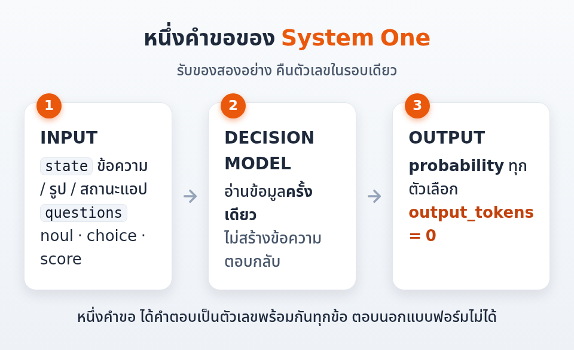
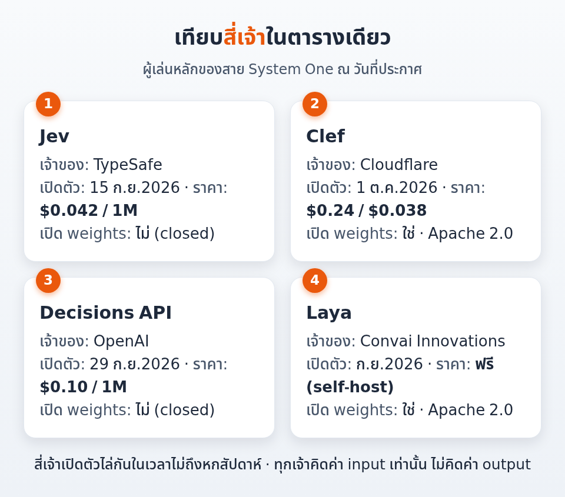
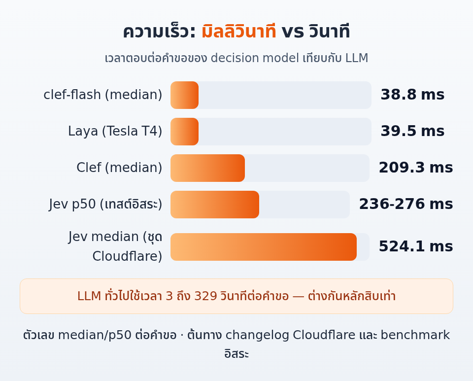
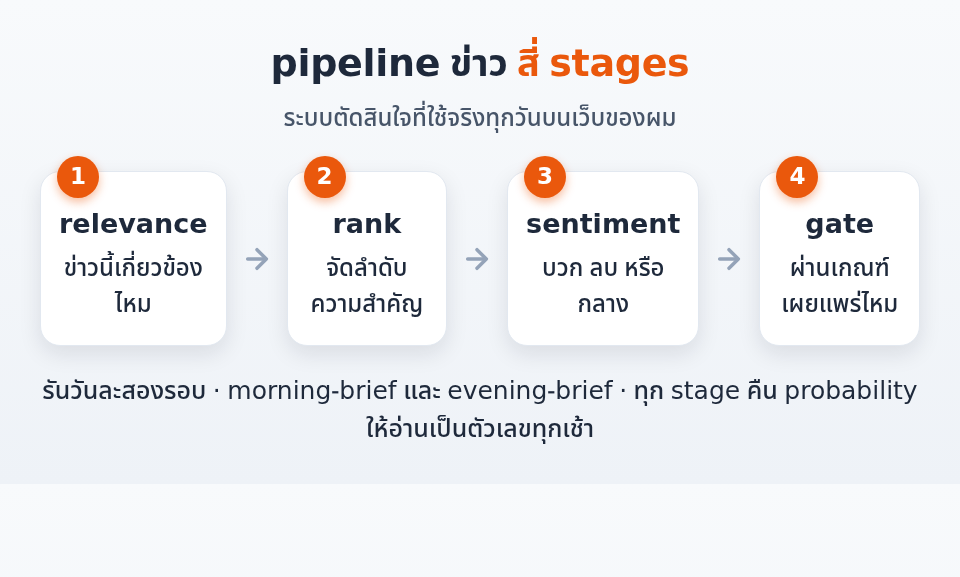
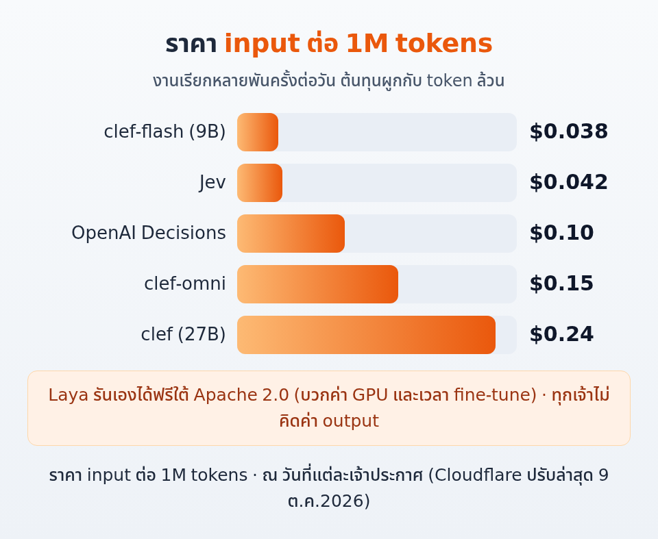

System One คือโมเดลตัดสินใจที่รับข้อมูลแล้วคืนเป็นตัวเลข probability หรือค่าบอกโอกาสถูกของแต่ละตัวเลือก โดยไม่สร้างข้อความตอบกลับเลย จึงแทน LLM ตรงจุดที่ต้องการแค่คำตอบแบบมีตัวเลือก เช่น ข่าวนี้เกี่ยวข้องไหม ตั๋วใบนี้ควรส่งทีมไหน ช่วงเดือนกันยายนถึงตุลาคม 2026 มี decision model เปิดตัวสี่เจ้าในเวลาไม่ถึงหกสัปดาห์ คือ Jev, Clef, OpenAI Decisions API และ Laya ระดับราคา input อยู่ที่ 0.038 ถึง 0.24 ดอลลาร์ต่อล้าน tokens และไม่มีเจ้าไหนคิดค่า output ผมใช้ระบบนี้แทน LLM ใน pipeline ข่าวของตัวเองทุกวัน ทั้งตอนคัดข่าวจัดลำดับ และตอนตรวจรูปก่อนเผยแพร่

## System One คืออะไร ทำไมถึงมาตอนนี้

ชื่อ System One มาจากหนังสือ Thinking, Fast and Slow ของ Daniel Kahneman ที่แบ่งการคิดของคนเป็นสองระบบ System 1 คือระบบคิดเร็วที่ตัดสินใจจากสัญชาตญาณและรูปแบบที่จำได้ ส่วน System 2 คือระบบคิดช้าที่ใช้เวลาใคร่ครวญยาว TypeSafe หยิบชื่อแรกมาตั้งเป็นชื่อตระกูล API เพื่อสื่อว่าโมเดลกลุ่นนี้ทำงานแบบคิดเร็ว รับข้อมูลปุ๊บแล้วสรุปผลปั๊บ

งานอย่างข่าวนี้ควรถือว่าเกี่ยวข้องไหม ตั๋วนี้ควรส่งให้ทีมไหน คำตอบถูกจัดไว้เป็นชุดอยู่แล้ว LLM ทั่วไปที่รับงานนี้จะสร้างข้อความตอบกลับมาให้เรา parse อีกชั้น โดย parse หมายถึงการอ่านคำตอบที่โมเดลเขียนกลับมาเพื่อแปลงเป็นข้อมูลที่โค้ดใช้ต่อได้ บางรอบตอบนอกแบบฟอร์ม บางรอบตีความพลาด ทั้งที่ปลายทางต้องการแค่ตัวเลขไปเทียบเกณฑ์

สาเหตุที่เรื่องนี้เป็นกระแสช่วงนี้เพราะผู้เล่นใหญ่เปิดตัวไล่กัน Jev จาก TypeSafe วันที่ 15 ก.ย.2026 ตามด้วย Decisions API จาก OpenAI วันที่ 29 ก.ย.2026 ที่งาน DevDay ในรูปแบบ limited preview ก่อนเข้า public beta และ GA วันที่ 22 ต.ค.2026 ต่อด้วย Clef ของ Cloudflare วันที่ 1 ต.ค.2026 และ Laya จาก Convai Innovations ที่ประกาศช่วงเดียวกัน เวลาไม่ถึงหกสัปดาห์มี decision model ให้เลือกใช้สี่เจ้า

อีกเหตุผลหนึ่งอธิบายด้วยชื่อของ Jev ที่ TypeSafe ตั้งตาม William Stanley Jevons พร้อมแนวคิดว่าเมื่อต้นทุนของปัญญาลดลงได้หลายเท่าตัว งานที่เคยเป็นไปไม่ได้จะเปิดออกเป็นชั้น ๆ ราคา input ระดับสิบเซนต์ต่อล้าน tokens ที่เห็นกันในตลาดตอนนี้ จึงทำให้หลายทีมย้ายงานจำแนกและจัดลำดับออกจาก LLM ตัวใหญ่ คนในสายเรียกจุดแบบนี้ว่า smart if-statement คือช่วงในโค้ดที่เงื่อนไขเขียนแบบตายตัวไม่ได้ เช่น ข้อความนี้เร่งด่วนไหม ระบบเดิมส่งไปให้ LLM แล้ว parse คำตอบที่ได้กลับมา แต่ decision model ตอบด้วย probability แทน โค้ดโดยรอบจึงจำกัดอิสระของโมเดลได้และประกอบเข้ากับระบบเดิมได้ง่าย

## หลักการทำงาน: รับสองอย่าง คืนเป็นตัวเลข

ทุกเจ้ารับของเดียวกันในการเรียกแต่ละครั้ง อย่างแรกคือ state หรือข้อมูลที่จะใช้ตัดสินใจ ซึ่งส่งมาเป็นข้อความ JSON รูปภาพ หรือสถานะของแอปได้ อย่างที่สองคือ questions ที่กำหนดชนิดคำตอบไว้ชัด มีสามชนิดที่ใช้กันหมด คือ `noul` สำหรับคำถามใช่หรือไม่ `choice` สำหรับเลือกจากชุดตัวเลือก และ `score` สำหรับให้คะแนนตามระดับที่เรียงไว้ ผลที่ได้กลับมาคือ probability ของทุกตัวเลือกในรอบเดียว

เพราะโมเดลไม่ได้สร้างข้อความใด ๆ ตอบกลับ คำตอบที่อยู่นอกชุดตัวเลือกจึงเป็นไปไม่ได้เลย และฝั่งรับผลไม่มี JSON เสีย ๆ หาย ๆ ให้ต้องซ่อม โค้ดที่รับ probability ทำงานง่ายคืออ่านค่าแล้วเทียบกับเกณฑ์ที่เขียนไว้ ค่าสูงกว่าเกณฑ์ก็ผ่านอัตโนมัติ ค่ากลางก็ส่งให้คนตรวจต่อ

ข้อกำหนดที่ควรรู้คือต่อหนึ่งคำขอถามได้สูงสุด 64 คำถาม ตัวเลือกของ `choice` รับตั้งแต่ 2 ถึง 255 ข้อ และ `score` รับตั้งแต่ 2 ถึง 10 ระดับ ด้านวิธีฝึก TypeSafe ตั้งชื่อเทคนิคของตัวเองว่า RLCD ย่อจาก Reinforcement Learning for Calibrated Decisions ซึ่งฝึกให้โมเดลคืน probability ที่เทียบเกณฑ์ได้จริง Cloudflare ใช้ชื่อ RLCD เรียกขั้น reinforcement learning ของ Clef เช่นกัน สองเจ้านี้จึงมีรากวิธีฝึกที่ใกล้เคียงกัน

## เทียบทุกเจ้า: Jev, Clef, OpenAI Decisions, Laya

ทั้งสี่เจ้าทำงานบนหลักการเดียวกันที่อธิบายไว้ข้างต้น ต่างกันตรงที่ใครเป็นเจ้าของ ราคาเท่าไหร่ รันที่ไหนได้บ้าง และเก่งงานแบบไหน ตารางนี้รวมข้อมูล ณ วันที่แต่ละเจ้าประกาศไว้

| เจ้า | เจ้าของ | เปิดตัว | เปิด weights | input ต่อ 1M |
| --- | --- | --- | --- | --- |
| Jev | TypeSafe | 15 ก.ย.2026 | ไม่ | $0.042 |
| Clef | Cloudflare | 1 ต.ค.2026 | ใช่ | $0.24 / $0.038 |
| Decisions API | OpenAI | 29 ก.ย.2026 | ไม่ | $0.10 |
| Laya | Convai Innovations | ก.ย.2026 | ใช่ | ฟรี self-host |

Jev เป็นเจ้าแรกของรอบนี้ เปิดตัววันที่ 15 ก.ย.2026 ให้บริการผ่าน API อย่างเดียวและปิดน้ำหนักโมเดล ราคา $0.042 ต่อ 1M input tokens โดย output ฟรี ตัวเลขความเร็วที่ vendor ให้มาอยู่ที่ 70 ถึง 500 มิลลิวินาทีต่อคำขอ ส่วน benchmark อิสระวัดได้ p50 ที่ 236 ถึง 276 มิลลิวินาที

Clef ของ Cloudflare เปิดวันที่ 1 ต.ค.2026 แบ่งเป็นสามรุ่น คือ `clef` ตัวหลัก 27B ที่ $0.24, `clef-flash` ขนาด 9B ที่ $0.038 และ `clef-omni` ที่ $0.15 ทุกรุ่นเปิดน้ำหนักใต้ลิขสิทธิ์ Apache 2.0 ดาวน์โหลดจาก Hugging Face ไปรันเองได้ และไม่คิดค่า output ทุกรุ่น

OpenAI ประกาศ Decisions API วันที่ 29 ก.ย.2026 รันอยู่บน GPT-6 Luna คิดราคาเฉพาะ input ที่ $0.10 ต่อ 1M tokens ไม่มีค่า output ตามประกาศ รับทั้งข้อความและรูปภาพ แล้วคืนคำตอบแบบใดแบบหนึ่งจาก probability, selection และ rubric score

Laya จาก Convai Innovations ต่างจากสามเจ้าตรงที่เปิด weights ใต้ Apache 2.0 ตัวโมเดลเล็กเพียง 421M พารามิเตอร์ สร้างจาก ModernBERT-large ต่อเข้ากับ typed decision head ติดตั้งด้วย `pip install laya` แล้วรันในเบราว์เซอร์ได้ แต่ checkpoint พื้นฐานยังแม่นไม่พอ ต้อง fine-tune ก่อนใช้งานจริง

## ใช้อะไรได้บ้าง

งานที่เหมาะกับ decision model คืองานที่คำตอบถูกจัดไว้เป็นชุดอยู่แล้ว ไล่ตั้งแต่

- classify ข้อความเข้าหมวด เช่น อ่าน intent ของผู้ใช้แล้วส่งต่อให้ flow ที่ถูกต้อง
- triage ตั๋วและงานแจ้งปัญหา ว่าเร่งด่วนแค่ไหนและทีมไหนควรรับ โดยไม่ต้องให้คนนั่งดูทีละใบ
- เลือก tool ให้ agent ว่าคำสั่งชุดนี้ควรเรียก function ตัวไหน ซึ่ง probability ที่ได้ใช้เทียบเกณฑ์ความมั่นใจในโค้ดต่อได้ทันที
- gate และ guardrail ตรวจว่าเนื้อหาหรือพฤติกรรมเข้าเกณฑ์ต้องบล็อกหรือไม่
- ให้คะแนนตาม rubric แทน LLM judge ที่ต้องอ่านคำตอบแล้วเขียนคะแนนกลับมา เพราะค่าตัวเลขคงที่และเทียบผลข้ามรอบได้
- จัดลำดับและตัดสินใจผ่านไม่ผ่านตามจุดต่าง ๆ ของ pipeline เช่น relevance, sentiment และ publish gate
- ดึงค่าจากฟอร์มหรืออีเมลแล้วส่งเข้า field ของระบบต่อ รวมถึงงาน real-time ที่เวลาตอบสนองมีผลต่อผู้ใช้ เช่น ตัดสินใจภายในหนึ่งร้อยมิลลิวินาทีระหว่างรอหน้าจอโหลด

ตัวอย่างโครงคำถามจากงานจริงคือ support ticket หนึ่งฉบับ ส่งเข้าไปพร้อมคำถามสามข้อ คือ `choice` ว่าเป็น bug, feature request, ค่าใช้จ่าย หรืออื่น ๆ, `score` ว่ารุนแรงระดับไหนตั้งแต่ไม่กระทบจนถึงปิดการใช้งานได้ และ `noul` ว่ามีขั้นตอน reproduce ระบุไว้ไหม ทั้งสามคำตอบกลับมาในคำขอเดียวพร้อม probability โค้ดจึงเลือกสายงาน เรียงลำดับความรุนแรง และส่งต่อให้ทีมรับผิดชอบได้ทันทีโดยไม่ต้องรอคนอ่านตั๋วทีละใบ

## ดีกว่า LLM ตรงไหน

เรื่องแรกคือความเร็ว LLM ทั่วไปใช้เวลา end-to-end ตั้งแต่ 3 ถึง 329 วินาทีตามตัวเลขของ TypeSafe ส่วน decision model อยู่ที่ระดับมิลลิวินาที งานที่อยู่บนเส้นทางรับคำขอจึงใส่ decision model ได้โดยผู้ใช้ไม่รู้สึกว่าช้า

| ตัวเลขความเร็ว | ค่าที่วัดได้ |
| --- | --- |
| Laya (Tesla T4, 1 คำถาม) | 32.8 ถึง 39.5 ms |
| clef-flash (median) | 38.8 ms |
| Clef (median) | 209.3 ms |
| Jev (p50, benchmark อิสระ) | 236 ถึง 276 ms |
| Jev (median ในชุดทดสอบของ Cloudflare) | 524.1 ms |
| LLM ทั่วไป (end-to-end) | 3 ถึง 329 วินาที |

เรื่องที่สองคือต้นทุน LLM ทั่วไปคิด input อยู่ที่ $0.20 ถึง $10 ต่อ 1M tokens และคิด output แพงกว่า input ราว 5 เท่า ขณะที่ decision model ทุกเจ้าคิดเฉพาะ input และไม่คิด output เลย เพราะโมเดลไม่ได้สร้างข้อความตอบกลับ งานที่ต้องเรียกหลายพันครั้งต่อวันจึงประหยัดกว่าชัดเจน

เรื่องที่สามคือรูปแบบคำตอบที่คงที่ ทุกคำขอได้ probability กลับมาในรูปเดียวกัน ไม่ต้องเขียนโค้ด parse ภาษา ไม่ต้องกันเคสที่โมเดลตอบนอกแบบ และไม่มี JSON เสีย ๆ ให้ซ่อม probability ทุกตัวเลือกยังเปิดทางให้ตั้งเกณฑ์แยกชั้นในโค้ดได้ เช่น ค่าสูงผ่านอัตโนมัติ ค่ากลางส่งให้คนตรวจ

เรื่องที่สี่คือความมั่นใจที่มาพร้อมคำตอบ TypeSafe ระบุว่า LLM ทั่วไปถ้าถูกขอให้ประเมินความมั่นใจมักจะประเมินเกินไปและไม่สม่ำเสมอ ทั้งที่งานที่ automate ได้จริงต้องการตรงกันข้าม คือโมเดลบอกได้ว่าข้อนี้มั่นใจแค่ไหน แล้วค่ามั่นใจที่สูงควรสอดคล้องกับความแม่นที่สูงตามไปด้วย decision model ทุกคำขอจึงมาพร้อม probability ช่วยให้ตั้งเกณฑ์แบ่งชั้นได้ชัดว่าข้อนี้ผ่านเอง ข้อนี้ส่งคนตรวจ หรือข้อนี้ส่งต่อให้โมเดลที่ใหญ่กว่าช่วยดูซ้ำ

## ใช้จริง: pipeline ข่าวของผม

pipeline ข่าวของเว็บตัวเองรันสองรอบต่อวันคือ morning-brief และ evening-brief แต่ละรอบมี decision stage สี่ตัวทำงานร่วมกัน relevance ว่าข่าวนี้เกี่ยวข้องกับโจทย์ไหม rank ว่าควรจัดลำดับความสำคัญแค่ไหน sentiment ว่าเป็นบวกหรือลบ และ gate สุดท้ายที่ตัดสินใจว่าผ่านเกณฑ์จะนำไปเผยแพร่หรือไม่

เดิมผมใช้ iApp OpenThai SystemOne เป็น decision engine ซึ่งช่วง preview ให้ใช้ฟรี 1,000 decisions ต่อวันต่อ key พอดีกับงานสองรอบ ปัจจุบันสลับมาใช้ Clef บน Workers AI ทั้งสอง profile ของ pipeline แล้ว

นอกจาก triage ข่าว ผมยังมี publish_gate.py กับ clef_vision.py ที่ใช้ Clef ตรวจรูปก่อนเผยแพร่ เช่น ตรวจว่ามี alt text และรูปตรงกับหัวข้อหรือไม่ ถ้าตรวจไม่ได้ระบบจะ fail-open ซึ่งหมายถึงให้ผ่านไปก่อนเพื่อไม่ให้บทความต้องค้างรอ

ผลที่ได้กลับมาเป็นตัวเลขที่อ่านได้ทุกวัน relevance ผ่าน 14 จาก 17 รายการ gate ด้านอารมณ์ได้ 0.02 และ gate ด้าน 5W1H ได้ 0.74 ทุกเช้ามี cron อ่านค่าเหล่านี้ยืนยันว่าระบบยังตอบจริง การได้ตัวเลขคืนมาจึงเท่ากับการได้การมองเห็นการทำงานของ pipeline กลับมาด้วย

## ตัวอย่างแบบก่อนและหลัง

**กรณีที่ 1: จำแนกหมวดเว็บไซต์** ทีม Threat Intelligence ของ Cloudflare มี workflow เปิดและจำแนกหมวดโดเมนเว็บ ตอนใช้ LLM ทั่วไปอย่าง gpt-oss-120b ใช้เวลา 4.7 วินาทีและได้ผลลัพธ์แค่สองคลาส พอเปลี่ยนมาใช้ Clef คู่กับ Browser Run เวลาลดเหลือ 2.2 วินาที แล้วยังได้ probability ของทุกคลาส เช่น โอกาสที่โดเมนเป็นเว็บแฟชั่น 95% e-commerce 85% และมีโอกาสเป็น phishing ต่ำกว่า 1% ทุกค่าเอาไปเทียบเกณฑ์ในระบบทันทีโดยไม่ต้องรอคนมานั่งอ่านผล

**กรณีที่ 2: ต้นทุนต่อการตัดสินใจ 1 ล้านครั้ง** ถ้างานรับตั๋วครั้งละ 500 tokens เรียก `clef-flash` 1 ล้านครั้งตกที่ 19 ดอลลาร์ ส่วน median latency ที่ 38.8 มิลลิวินาทีทำให้ตัวตัดสินใจตัวนี้วางบนเส้นทางรับคำขอได้โดยผู้ใช้ไม่รู้สึกว่าช้า งบที่คาดการณ์ได้ล่วงหน้ากับเวลาตอบสนองที่พอใส่ในจุดรับคำขอได้จริง คือสองอย่างที่ได้กลับมาพร้อมกัน

## ค่าใช้จ่ายเทียบกัน

ราคาของ decision model ง่ายกว่า LLM ตรงที่คิดเฉพาะ input เท่านั้น ตารางนี้รวมทุกเจ้า ณ วันที่ที่แต่ละเจ้าประกาศไว้

| เจ้า | input ต่อ 1M | output | เปิด weights |
| --- | --- | --- | --- |
| Jev | $0.042 | ฟรี | ไม่ |
| Clef | $0.24 (27B) / $0.038 (9B flash) | ฟรี | ใช่ (Apache 2.0) |
| OpenAI Decisions | $0.10 | ฟรี (ตามประกาศ) | ไม่ |
| Laya | ฟรี self-host (บวกค่า GPU) | ฟรี | ใช่ (Apache 2.0) |

ลองคำนวณดูง่าย ๆ ด้วยสมมติฐาน 1 ล้านคำขอ ครั้งละ 500 tokens ซึ่งเท่ากับ 500 หน่วยของราคาต่อ 1M จะได้ Jev ที่ $21, `clef-flash` ที่ $19, `clef` ตัวหลักที่ $120 และ OpenAI ที่ $50 ตัวเลขของ Jev ตรงกับที่ eesel.ai เทียบไว้ ส่วน LLM อย่าง GPT-6 Luna ในการคำนวณชุดเดียวกันได้ $27.50 แบบ batch และ $55 แบบ standard

วิธีประเมินงบรายเดือนของงานตัวเองทำได้ในสี่ขั้นตอน

1. นับจำนวนคำขอต่อวันของงานนั้น
2. คูณด้วย tokens ต่อคำขอ
3. คูณจำนวนวันในเดือน แล้วหารด้วยหนึ่งล้านเพื่อแปลงเป็นหน่วยราคาต่อ 1M
4. คูณอัตรา input ของเจ้าที่เลือก เพื่อออกเป็นตัวเงิน

ตัวเลขราคาเหล่านี้เป็นราคา ณ วันที่ที่ระบุไว้และเปลี่ยนได้ตลอด ย้อนไปวันที่ 9 ต.ค.2026 Cloudflare เพิ่งลดราคา `clef-flash` จาก $0.09 เหลือ $0.038 มาแล้ว ข้อควรทำเสมอก่อนวางแผนงบจึงคือการเช็ค changelog และหน้าราคาของแต่ละเจ้า

## หลักการเลือกใช้

ถ้าจะเลือกสักเจ้าให้เริ่มจากเงื่อนไขของงานตัวเองแล้วไล่ดูตามนี้

- ต้องการรันเองหรือข้อมูลห้ามออกนอกระบบ เลือก Clef หรือ Laya ซึ่งเปิด weights ภายใต้ Apache 2.0 โดย Laya เล็กและเร็วกว่าแต่ต้อง fine-tune ก่อน ส่วน Clef ตัวใหญ่กว่าและหยิบมาใช้ได้เลย
- ต้องการความเร็วสูงสุดบนคลาวด์ เลือก `clef-flash` ที่ median 38.8 มิลลิวินาที
- ต้องการราคาถูกสุดแบบ hosted เลือก Jev ที่ $0.042 ต่อ 1M input tokens
- อยู่ในจักรวาล OpenAI อยู่แล้ว หรือต้องการส่งข้อความและรูปเข้าที่เดียว Decisions API คือคำตอบที่เข้าทางที่สุด
- ต้องการให้ confidence ที่คืนมาเชื่อถือได้ ให้ดูค่า ECE เป็นหลัก โดย ECE คือค่าวัดว่าความมั่นใจที่โมเดลบอกตรงกับความแม่นจริงแค่ไหน ยิ่งต่ำยิ่งดี เช่น Laya ที่ 0.081 เทียบกับ Jev ที่ 0.246
- งาน classification ที่มีตัวเลือกเยอะระดับสิบ ๆ หมวด Jev ทำ Banking77 ได้ 0.870 และ Clef รายงาน macro-F1 ที่ 94.2 ส่วน Laya base ได้แค่ 0.425 จึงไม่ใช่ตัวเลือกแรกสำหรับงานแบบนี้

วิธีทดสอบของผมมาจากที่ flaviocopes แนะนำ คือเขียน inputs 20 ชิ้นที่รู้คำตอบอยู่แล้วจากงานจริง แล้วยิงเข้าทุกเจ้าเพื่อเทียบ accuracy หรือความแม่นกับ confidence ที่คืนมา วิธีนี้ใช้เวลาไม่นานและช่วยตัดเจ้าที่ไม่เข้ากับงานได้ก่อนจะผูกระบบจริง

ถ้าจะให้เป็นขั้นตอนเริ่มต้น ก็ทำตามนี้

1. ถามตัวเองว่างานนี้นิยามคำตอบที่ถูกต้องได้จริงไหม ถ้ายังนิยามไม่ได้ให้ไปออกแบบ taxonomy หรือชุดหมวดหมู่ของคำตอบก่อน
2. ดูเงื่อนไขบังคับ เช่น ข้อมูลห้ามออกนอกระบบ หรือเวลาตอบสนองต้องต่ำกว่ากี่มิลลิวินาที
3. คัดให้เหลือสองเจ้า แล้วยิงชุดทดสอบ 20 inputs เทียบกัน
4. ตัดสินใจผูกระบบจริงกับเจ้าที่ชนะ โดยรันระบบเดิมคู่กันไปก่อนในช่วงแรก

## ข้อจำกัดที่ควรรู้ก่อนเริ่ม

ข้อแรก decision model ตอบได้เฉพาะตัวเลือกที่เราออกแบบไว้เท่านั้น งานที่ต้องร่างข้อความยาว แต่งประโยค หรือให้เหตุผลอิสระ จึงยังเป็นหน้าที่ของ LLM ที่ต้องรับช่วงต่อ

ข้อสอง คุณภาพของคำตอบผูกกับการออกแบบคำถามโดยตรง ถ้าชุด `choice` ไม่ครอบคลุมสถานการณ์จริง probability ที่ได้ก็สะท้อนชุดตัวเลือกแคบ ๆ นั้น งานที่ยังตอบไม่ได้ว่าคำตอบที่ถูกต้องคืออะไร ระหว่างนั้นลองให้ LLM ช่วยร่าง taxonomy ของคำตอบก่อน แล้วค่อยย้ายเมื่อเกณฑ์นิ่ง

ข้อสาม ข้อจำกัดเชิงตัวเลขของแต่ละเจ้า Jev และ Clef ถามได้สูงสุด 64 คำถามต่อหนึ่งคำขอ ถ้ามีหัวข้อตัดสินใจเกินกว่านั้นต้องแบ่งส่งหลายรอบ Laya มีข้อจำกัดเพิ่มตรงที่ตัวเลือกเกิน 20 ข้อแล้วความแม่นลดลง เพราะ head budget แค่ 256 token และ ordinal scoring ก็เป็นจุดอ่อนที่สุด

ข้อสี่ ความเสี่ยงเรื่องการพึ่งพา service ราคาและเงื่อนไขของ hosted เปลี่ยนได้เสมอ บทเรียนของผมคือ API เจ้าอื่นค้าง HTTP 500 ต่อเนื่องหลายวันโดยไม่มีประกาศ ระบบจึงควรมี fail-over และจุด fail-open ที่ออกแบบไว้ล่วงหน้า ส่วนคนที่จะ self-host ต้องเช็คฮาร์ดแวร์ก่อน เครื่องผมเป็น Xeon รุ่น Ivy Bridge ไม่มีชุดคำสั่ง AVX2 ซึ่งเป็นชุดคำสั่งประมวลผลบนซีพียูรุ่นใหม่ ทำให้ torch เวอร์ชันใหม่กว่า 2.4 โหลดโมเดลไม่ได้

ข้อห้า benchmark ในตลาดนี้ถูกแทนที่เร็ว คะแนนที่เห็นวันนี้อาจถูกแซงในสัปดาห์หน้า จึงควรเช็คคะแนนล่าสุดก่อนตัดสินใจผูกกับเจ้าไหน และดูค่า calibration อย่าง ECE ประกอบด้วย เพราะ accuracy สูงอย่างเดียวไม่บอกว่า probability ที่คืนมาเชื่อถือได้แค่ไหนในทางปฏิบัติ

ข้อหก คำตอบไม่มีคำอธิบายมาด้วย decision model คืน probability อย่างเดียว ไม่ได้บอกเหตุผลว่าทำไมถึงให้ค่านั้น งานที่ผู้ตรวจต้องรู้ว่าโมเดลประเมินอย่างไร เช่น รายงานตรวจสอบหรือคำตัดสินที่มีคนโต้แย้ง จึงต้องเก็บเหตุผลเพิ่มจากแหล่งอื่น เช่น ส่งข้อมูลชุดเดียวกันไปให้ LLM แต่งคำอธิบายแยก หรือให้คนตรวจสรุปเหตุผลเอง

## สรุป

ทั้งสี่เจ้าพอสรุปสั้น ๆ ได้แบบนี้ Jev เป็น hosted ที่ราคาถูกที่สุดที่ $0.042 ต่อ 1M input tokens Clef เป็นตัวที่ได้ความเร็ว ราคา และ open weights ไปพร้อมกัน โดย `clef-flash` ที่ median 38.8 มิลลิวินาทีเหมาะกับงานบนเส้นทางรับคำขอ OpenAI Decisions API เหมาะกับคนที่อยู่ใน ecosystem ของ OpenAI อยู่แล้วหรือต้องการส่งข้อความและรูปเข้าที่เดียว ส่วน Laya คือทางเลือก self-host ที่เล็กและเร็วเมื่อผ่านการ fine-tune แล้ว ข้อแลกเปลี่ยนคือการคุมข้อมูลทุกอย่างเอง

อีกสัญญาณที่ควรจับตาคือ API ของแต่ละเจ้าที่เริ่มใกล้เคียงกัน อย่าง Clef ใช้รูปแบบเดียวกับ System One ของ TypeSafe ทำให้โค้ดที่เขียนไว้กลางระหว่างเจ้าหนึ่งย้ายไปอีกเจ้าได้ด้วยการเปลี่ยนชื่อโมเดล ตลาดที่ย้ายง่ายแบบนี้ผู้ใช้ได้เปรียบ เพราะไม่ต้องผูกตายกับเจ้าเดียวเวลาถูกปรับราคาหรือหยุดให้บริการ

ขั้นเริ่มต้นที่ทำได้ทันทีคือการยิงชุดทดสอบ 20 inputs ที่เขียนไว้แล้วเข้าทุกเจ้า แล้วเลือกตัวที่ชนะมาทดลองทีละจุดโดยรันระบบเดิมคู่กันไปก่อน จนค่า probability ของทุก stage สอดคล้องกันหลายวันจึงค่อยปิดของเดิม

กลับมาที่คำถามแรกของบทความว่า System One ใช้แทน LLM ตรงไหน คำตอบสั้น ๆ คืองานที่คำตอบถูกจัดไว้เป็นชุดและต้องการตัวเลขไว้เทียบเกณฑ์ ส่วนราคา ณ วันที่ประกาศที่ยกมาอ้างในบทความนี้อาจเปลี่ยนไปเมื่อมี changelog ใหม่ ใครจะตัดสินใจผูกระบบจริงจึงควรเช็คหน้าเอกสารและ changelog ของเจ้าที่เลือกก่อนเป็นอันดับแรก

## Sources

1. https://typesafe.ai/blog/introducing-system-one-models-and-jev
2. https://blog.cloudflare.com/clef-decision-models
3. https://developers.cloudflare.com/changelog/post/2026-10-01-clef-workers-ai
4. https://developers.cloudflare.com/changelog/post/2026-10-09-clef-omni-workers-ai
5. https://developers.cloudflare.com/workers-ai/models/clef
6. https://developers.cloudflare.com/workers-ai/models/clef-flash
7. https://developers.cloudflare.com/workers-ai/models/clef-omni
8. https://huggingface.co/Cloudflare/clef
9. https://flaviocopes.com/clef
10. https://community.openai.com/t/decisions-api-is-now-available-in-public-beta/1403877
11. https://prolyz.com/blog/jev-vs-laya-hosted-vs-open-weight-decision-models
12. https://eesel.ai/blog/openai-decisions-api-pricing
13. https://dev.to/vishalmysore/what-is-laya-laya-vs-jev-with-live-demo-4j6e
